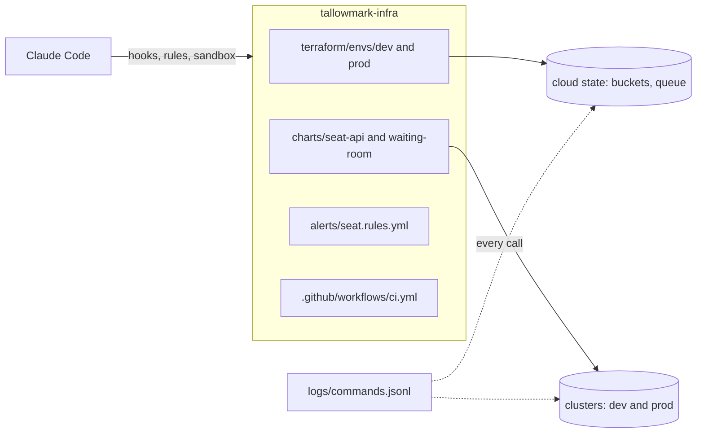

# Start here

This part sets up the **Goal** you will prove at the end: a guard that blocks 30 of 30 dangerous calls.

You set up the repo, meet Tallowmark Tickets, run the finished system and see the goal. Then Claude Code writes
three lines about what you saw. You check them, and the course check reads them.

You write no code in this course. You type prompts into the real Claude Code, read its plan, and say yes or no.

## Setup

You need [Bun](https://bun.sh) 1.4.4, git, and Claude Code signed in with your own Claude account (a Pro or Max
plan, or a Console account). You do not need Docker, a cloud account or an API key: the world runs on your laptop,
and every check reads files and the world's logs, never what Claude said.

Install Claude Code with the official installer ([Set up Claude Code](https://code.claude.com/docs/en/setup)). On
macOS, Linux or WSL:

```sh
curl -fsSL https://claude.ai/install.sh | bash
```

Expect: no progress output while it downloads. On Windows, use the PowerShell command on that page.

Open a new terminal, run `claude`, type `/login` and sign in in the browser. Then check what you have:

```bash
claude --version
```

Expect: `(Claude Code)` after a version number.

The course is tested on Claude Code 2.1.311 to 2.1.322. The doctor below tells you if yours is older.

Now set up the repo and the world:

```bash
bun install
bun run doctor
bun run world
```

Expect: one line each for `Bun`, `git`, `Claude Code` and `Signed in`, then
`The world is ready: Tallowmark Tickets with 5 faults planted.` and two `export PATH` and `cd` lines to copy.

You can also work in Claude Code inside VS Code or JetBrains, or in the Code tab of Claude Desktop: open the world
repo folder there. The settings, hooks and `CLAUDE.md` that Claude Code writes for you are the same files in every
one of them.

## Meet the world

Tallowmark Tickets sells concert tickets. Its platform team of four owns one repo, `tallowmark-infra`, copied to
`world/live/tallowmark-infra`. It runs:

- `seat-api`: seat holds and checkout. Down means no sales.
- `waiting-room`: the queue fans wait in when a big show goes on sale.
- the scan store: a bucket and a queue for door scanner readings from every show.
- the buyer records bucket: names, emails and payment references. It must never be public.

There are two environments, `dev` and `prod`. The programs `terraform`, `kubectl`, `helm` and `aws` in `world/bin`
are not the real tools. They act on the world's own state, not a real cloud. So a destroy really destroys something
you can see, and nothing real breaks. Every call is saved in `world/live/logs/commands.jsonl`.

For example, run `terraform -chdir=terraform/envs/dev plan` in the world repo. It prints a plan for the world's dev
state, and a new line appears in `commands.jsonl`.



## See the goal

The board shows everything the course turns green: five planted faults and the guard suite score.

```bash
bun run board
```

Expect: five `RED` lines and `Dangerous actions blocked:   0 of 30`.


## Run the finished system

The finished system is the same world with every step's sample answer in place. It is built next to yours in
`world/.finished`, so your world stays as it is. With Claude Code signed in, it runs Claude Code for real: a headless
`claude -p` reviews 6 saved Terraform plans, and a second session works on prod's drifted bucket with the finished
guardrails on. Then it checks what those runs left behind. Without Claude Code it replays real recorded runs and says
so in one line.

```bash
bun run finished
```

Expect: `Guard suite: blocked 30 of 30 dangerous calls, allowed 15 of 15 safe calls, broken input blocked.`,
`saved plans judged right`, `left prod for a person and wrote the review` and `Everything is green.`

Then watch a real recorded session: an on-call engineer tells Claude Code to apply on prod, and the finished guard
hook stops it. Each command in it is handed again to the guard on your machine.

```bash
bun run demo
```

Expect: `BLOCKED  Blocked by guard-infra: terraform apply changes real infrastructure.` and
`Changes it made to the world: 0.`

## Walkthrough

Your one step here is [meet-the-world](meet-the-world/problem/README.md). Get Claude Code to fill in
`notes/first-look.md` in its `problem/` folder. Check the note, then run:

```bash
bun run verify meet-the-world
```

Expect: `1 of 4 rules pass.` while the note is still the starter.

Once the note is filled in and checked, the same command ends with `Done. All 4 rules pass.`

When a command prints something you do not expect, look it up in [troubleshooting.md](troubleshooting.md).
