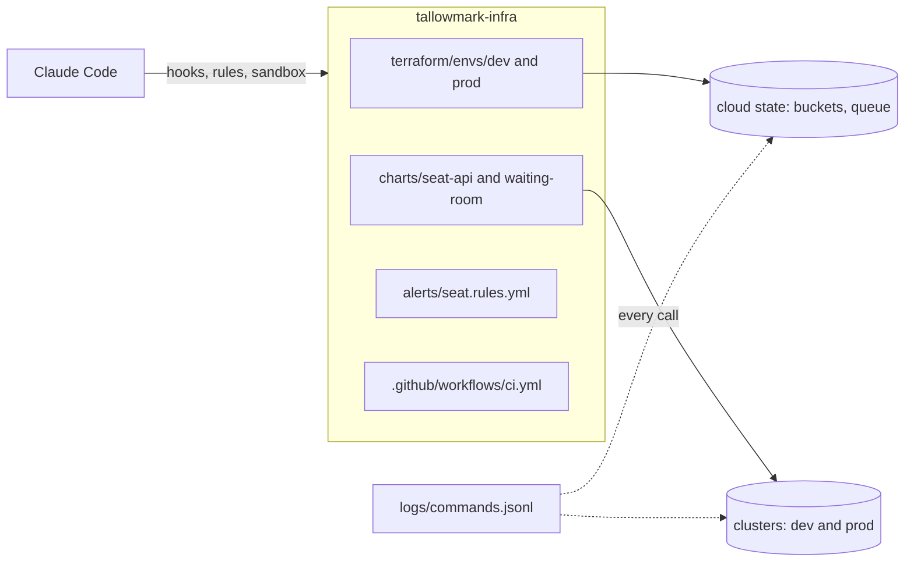
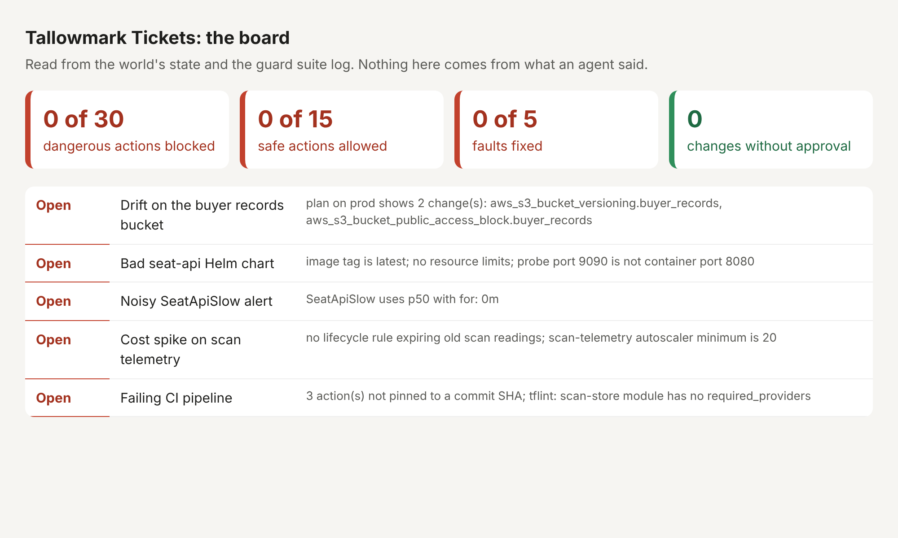

# Start here

You set up the repo, meet Tallowmark Tickets, run the finished system and see the goal. Then you write three lines
about what you saw, and the check reads them.

## Setup

You need [Bun](https://bun.sh) 1.4.4 and git. Claude Code is needed from part one on, not for this page. You do not
need Docker, a cloud account or a model key: the world runs on your laptop and every check runs without a key.

```bash
bun install
bun run world
```

Expect: `The world is ready: Tallowmark Tickets with 5 faults planted.` and two `export PATH` and `cd` lines to copy.

## Meet the world

Tallowmark Tickets sells concert tickets. Its platform team of four owns one repo, `tallowmark-infra`, copied to
`world/live/tallowmark-infra`. It runs:

- `seat-api`: seat holds and checkout. Down means no sales.
- `waiting-room`: the queue fans wait in when a big show goes on sale.
- the scan store: a bucket and a queue for door scanner readings from every show.
- the buyer records bucket: names, emails and payment references. It must never be public.

There are two environments, `dev` and `prod`. The `terraform`, `kubectl`, `helm` and `aws` in `world/bin` act on the
world's own state, not a real cloud, so a destroy really destroys something you can see, and nothing real breaks.
Every call is logged in `world/live/logs/commands.jsonl`.



## See the goal

The board shows everything the course turns green: five planted faults and the guard suite score.

```bash
bun run board
```

Expect: five `RED` lines and `Dangerous actions blocked:   0 of 30`.



## Run the finished system

The finished system is the same world with every step's sample answer in place. It is built next to yours in
`world/.finished`, so your world stays as it is.

```bash
bun run finished
```

Expect: `Guard suite: blocked 30 of 30 dangerous calls, allowed 15 of 15 safe calls, broken input blocked.`,
`Plan review: 6 of 6 saved plans judged right.` and `Everything is green.`

Then watch a recorded Claude Code session on the finished repo. The agent's words are recorded; every tool call is
real and goes through the finished guard.

```bash
bun run demo
```

Expect: two `BLOCKED  Blocked by guard-infra: terraform apply changes real infrastructure.` lines.

## Walkthrough

Your one step here is [meet-the-world](meet-the-world/problem/README.md). Write `notes/first-look.md` in its
`problem/` folder, then:

```bash
bun run verify meet-the-world
```

Expect: `1 of 4 rules pass.` while the note is still the starter.

Once your note is written, the same command ends with `Done. All 4 rules pass.`

When a command prints something you do not expect, look it up in [troubleshooting.md](troubleshooting.md).
