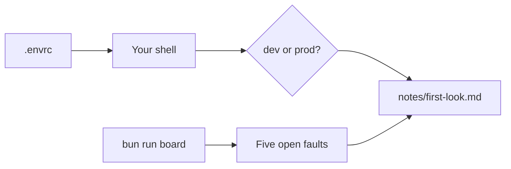
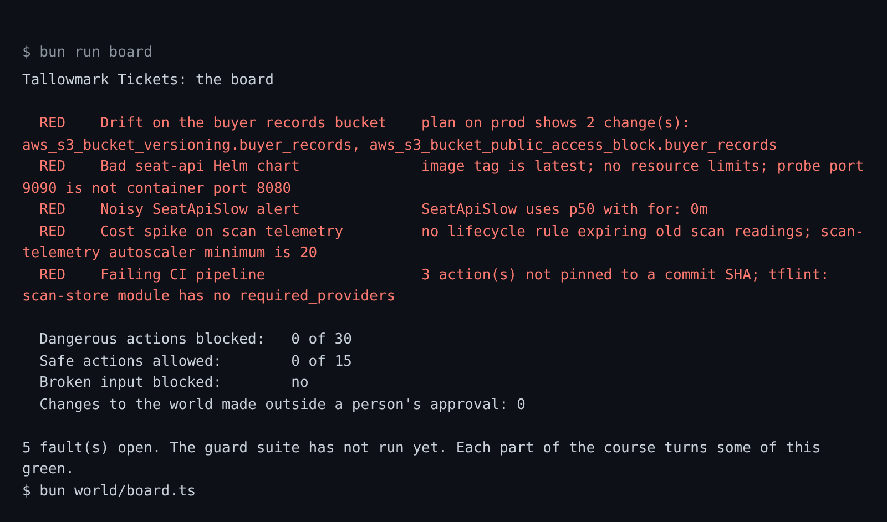

# Meet the world

## The problem

Before you let an agent into an infra repo, ask what a new teammate would ask:

1. Which environment am I pointed at?
2. What is already broken?
3. What must never run?

Most laptops answer the first question badly. This repo's `.envrc` file is one of them.



## Your challenge

You explore with Claude Code. It writes the note. You check every line.

Start Claude Code in the root folder of this course repo, in plan mode. Ask it to look first:

```text
Read world/live/tallowmark-infra/.envrc and run bun run board.
Then fill in 00-orientation/meet-the-world/problem/notes/first-look.md under its four headings:
1. Where my shell points: the one environment the .envrc points at, and the line that shows it.
2. The fault that worries me most: one fault from the board, by name, and why.
3. A command I would never let an agent run: one command, in backticks, that changes or deletes something.
4. How I asked: say you used plan mode, point at a file with @, and link a screenshot of the board in notes/.
```

Run them yourself to see the same lines:

```bash
cat world/live/tallowmark-infra/.envrc
bun run board
```

Expect: the `.envrc` lines, then the board with five `RED` lines.

For example, the `.envrc` has a line that starts with `export TALLOWMARK_ENV=`. The word after it is the
environment your shell points at.

Check each line against what you saw:

- Does the environment match the `TALLOWMARK_ENV` line? Say no to a guess of `dev`.
- Is the fault one of the five `RED` lines on the board?
- Does the command change or delete something? `terraform plan` only reads, so it is the wrong answer.

The prompt that solves this step is in `../solution/prompts.md`. Read it after you try.

## Done when

- The note has the four headings.
- It names the environment the world really points at.
- It names one of the five faults.
- Its command is one the finished guard blocks.
- A fourth heading, How I asked, says you used plan mode, pointed at a file with `@`, and shows a screenshot.

Ask Claude Code to check your work:

```text
Run the check for meet-the-world and tell me what it printed. Do not change anything to make it pass.
```

You can also run it yourself:

```bash
bun run verify meet-the-world
```

Expect: `Done. All 5 rules pass.`



## If you get stuck

| What you see | What to ask Claude Code |
|---|---|
| `FAIL you found which environment the shell points at` | "Read `TALLOWMARK_ENV` in `.envrc`. Name only that one, and do not name the other environment at all." |
| `FAIL the command you named is one the finished guard blocks` | "`terraform plan` is safe. Pick a command that applies, destroys or deletes." |
| `FAIL notes/first-look.md has the three headings` | "Put the three headings back exactly as the starter has them." |

## Words you will use

- **Environment**: a full copy of the platform. `dev` is for trying things. `prod` is where fans buy tickets.
- **Drift**: the cloud no longer matches the Terraform code. Someone changed the cloud directly, not through
  Terraform.
- **The board**: one screen with every fault and the guard score. It reads the world's state and logs.
