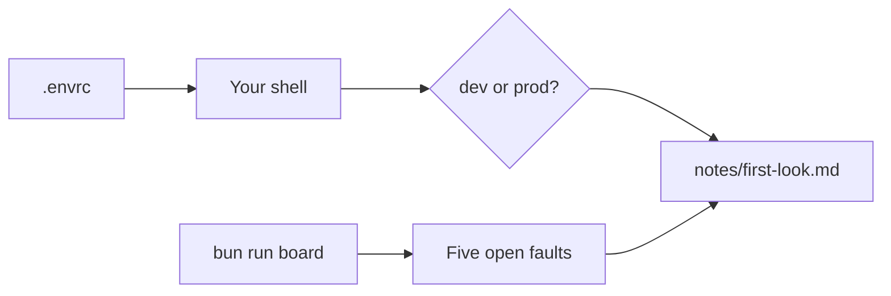

# Meet the world

## The problem

Before you let an agent into an infra repo, you need to know three things a new teammate would ask: which
environment am I pointed at, what is already broken, and what must never run. Most laptops answer the first one badly.
This repo's `.envrc` is one of them.



## Your challenge

Explore `world/live/tallowmark-infra` with the world's tools on your PATH (from `bun run world`). Useful commands:

```bash
cat world/live/tallowmark-infra/.envrc
bun run board
```

Expect: the `.envrc` lines, then the board with five `RED` lines.

Then fill in `notes/first-look.md` in this folder, under its three headings:

1. **Where my shell points**: the one environment the repo's shell points at, and how you know.
2. **The fault that worries me most**: one fault from the board, by name, and why.
3. **A command I would never let an agent run**: one command, in backticks, that would change or delete something.

## Done when

- The note has the three headings.
- It names the environment the world really points at.
- It names one of the five faults.
- Its command is one the finished guard blocks.

```bash
bun run verify meet-the-world
```

Expect: `Done. All 4 rules pass.`


## If you get stuck

| What you see | Fix |
|---|---|
| `FAIL you found which environment the shell points at` | Read `TALLOWMARK_ENV` in `.envrc`. Name only that one. |
| `FAIL the command you named is one the finished guard blocks` | `terraform plan` is safe. Pick one that applies, destroys or deletes. |
| `FAIL notes/first-look.md has the three headings` | Keep the headings exactly as the starter has them. |

## Words you will use

- **Environment**: a full copy of the platform. `dev` is for trying things, `prod` is where fans buy tickets.
- **Drift**: the cloud no longer matches the Terraform code, because someone changed it by hand.
- **The board**: one screen with every fault and the guard score, read from the world's state and logs.
