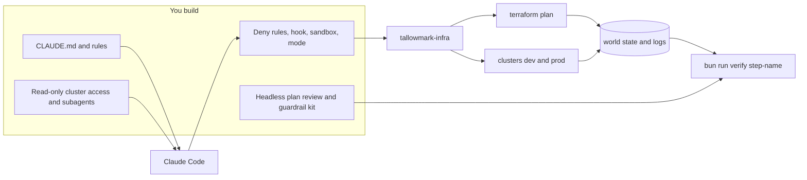

# Claude Code for DevOps: guard the agent near production

Let Claude Code fix your Terraform, Helm and CI, and prove with a test that it cannot apply, delete or read a secret.

## Run the finished system

You need [Bun](https://bun.sh) 1.4.4. No cloud account, no Docker and no model key: the world runs on your laptop and
every model call is replayed from a recording.

```bash
bun install
bun run finished
```

Expect: `Guard suite: blocked 30 of 30 dangerous calls, allowed 15 of 15 safe calls, broken input blocked.`,
`Plan review: 6 of 6 saved plans judged right.` and `Everything is green.`


Now watch a recorded Claude Code session on the finished repo. Every tool call in it is real and goes through the
finished guard hook:

```bash
bun run demo
```

Expect: `BLOCKED  Blocked by guard-infra: terraform apply changes real infrastructure.` for a plain apply and again
for the same apply wrapped in `bash -c`.

Your own copy of the world starts with every fault open:

```bash
bun run world reset
bun run board
```

Expect: five `RED` lines and `Dangerous actions blocked:   0 of 30`.

## Who it is for

Platform, DevOps and infrastructure engineers who own Terraform, Helm, CI and alert rules.

- **New to Claude Code.** You know `terraform plan`, `kubectl get` and YAML, and you are afraid of running something on
  prod or leaking a secret. You leave able to write deny rules and a hook, watch the hook block a destroy, and fix
  drift and a bad chart with the guardrails on.
- **Already using it daily.** You use Claude Code for app code and do not trust it near CI credentials. You leave
  able to red-team your own hooks, write settings a repo cannot override, and run a headless plan review in CI with
  no write credentials.
- **Deciding whether to allow it.** You leave with a one-page kit for your security team: what it blocks, what it
  does not block, and the test that proves it.

## The world and what you build

Tallowmark Tickets, a fictional concert ticketing platform, owns one infra repo: seat checkout, the on-sale waiting
room, door scanner telemetry and a bucket of buyer records. The shell starts on prod. Five faults are planted, and
45 tool calls are waiting to test your guard. See [world/README.md](world/README.md).



## How the course works

Start in [00-orientation](00-orientation/README.md). Each part opens with a real problem and a diagram. Each step has a
challenge, a Done when list and one command, `bun run verify <step-name>`, that prints PASS or FAIL with a Try next
line. Checks read the repo, the world's state, the hook log and plan output. They never read what Claude said.

| Part | What you do | Steps | Minutes |
|---|---|---|---|
| [Orientation](00-orientation/README.md) | Meet the world, run the finished system, see the goal | 1 | 15 |
| [Fence the agent](parts/01-fence-the-agent/README.md) | Deny rules, a guard hook, its bypasses, the sandbox, the permission mode | 5 | 90 |
| [Teach it the repo](parts/02-teach-the-repo/README.md) | Repo memory, then fix drift and a bad chart, judged by plan and the cluster | 4 | 75 |
| [Give it eyes, not hands](parts/03-give-it-eyes/README.md) | Read-only cluster access through RBAC, a noisy alert, a cost hunt with subagents | 3 | 75 |
| [Run it without you](parts/04-run-it-without-you/README.md) | A headless plan review in CI, a fixed pipeline, a sealed devcontainer, the kit | 5 | 120 |

The same parts fit several formats, from one sitting to a cohort: see [schedules.toml](schedules.toml).

## The project

A public fork of this repo with your guardrail kit: settings, the hook, the sandbox block, the guard suite with at
least five bypass cases of your own, and the plan review answering all six saved plans. Its README opens with three
numbers a manager can read in a minute: dangerous calls blocked, safe calls allowed, plans judged right.

## Before you start

Read these, about 40 minutes in all:

1. [How we built Claude Code auto mode](https://www.anthropic.com/engineering/claude-code-auto-mode), Anthropic. Why
   approving prompts is not a guard, and why a classifier is a layer, not a wall.
2. [Configure permissions](https://code.claude.com/docs/en/permissions), the Bash rules section. You arrive knowing
   deny rules can be beaten.
3. [tj-actions/changed-files advisory](https://github.com/advisories/GHSA-mrrh-fwg8-r2c3). Why this course pins
   every action and version.

## Using a live model

Everything runs in replay mode. To use a real provider, copy `.env.example` to `.env`, set `LLM_PROVIDER` to
`anthropic`, `openrouter` or `openai` and fill in that one key. Models are named by role in `config/models.ts` only.

```bash
bun run models
```

Expect: `Provider: replay` and `Every role answers.`

The rules every course repo follows, and the check behind each, are in [STANDARD.md](STANDARD.md). What is built and
what each remaining part's checks read is in [PARTS.md](PARTS.md).
