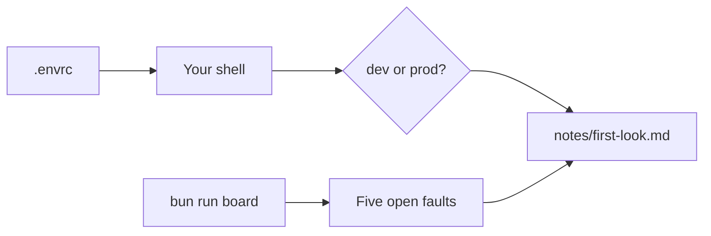
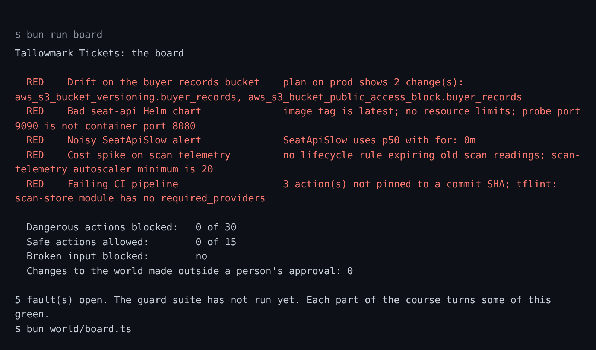

# Meet the world

## The problem

A new teammate asks which environment they are on, what is broken, and what must never run. Most laptops answer
the first question badly. In this repo, the `.envrc` file points your shell at prod, and the board shows five open
faults.



## Watch it done

The board you will see, before any guard exists:

```text
  RED    Noisy SeatApiSlow alert    SeatApiSlow uses p50 with for: 0m
  RED    Failing CI pipeline        3 action(s) not pinned to a commit SHA
5 faults open. Each part of the course turns some of this green.
```



## Your turn

1. Read the file and look at the board:

```bash
cat world/live/tallowmark-infra/.envrc
bun run board
```

Expect: the `.envrc` lines, then the board with five `RED` lines.

2. Start Claude Code in the root folder, in plan mode. Ask it to write the note:

```text
Read world/live/tallowmark-infra/.envrc and run bun run board.
Then fill in parts/00-orientation/01-meet-the-world/problem/notes/first-look.md under its four headings:
1. Where my shell points: the one environment the .envrc points at, and the line that shows it.
2. The fault that worries me most: one fault from the board, by name, and why.
3. A command I would never let an agent run: one command, in backticks, that changes or deletes something.
4. How I asked: say you used plan mode, point at a file with @, and link a screenshot of the board in notes/.
```

Expect: a note with four filled headings.

3. Check each line. For example, the word after `export TALLOWMARK_ENV=` is your environment. `terraform plan` only
reads, so it is the wrong command.

## Do it on your work

Open a repo you own. Ask Claude Code, in plan mode, for the same four-heading note about it. Good looks like this:
you can name the one environment, one real fault and one command you would block.

## Done when

- The note has the four headings and names the environment the world really points at.
- It names one of the five faults, and a command the finished guard blocks.
- How I asked says you used plan mode, pointed at a file with `@`, and shows a screenshot.

```bash
bun run verify meet-the-world
```

Expect: `Done. All 5 rules pass.`

## Solution

The finished note is in `../solution/notes/first-look.md`. The prompt that made it is in `../solution/prompts.md`.
The check passes on it.

## If you get stuck

| What you see | What to ask Claude Code |
|---|---|
| `FAIL you found which environment the shell points at` | "Read `TALLOWMARK_ENV` in `.envrc`. Name only that one, and do not name the other environment at all." |
| `FAIL the command you named is one the finished guard blocks` | "`terraform plan` is safe. Pick a command that applies, destroys or deletes." |
| `FAIL notes/first-look.md has the three headings` | "Put the three headings back exactly as the starter has them." |

## Words you will use

- **Environment**: a full copy of the platform. `dev` is for trying things. `prod` is where fans buy tickets.
- **The board**: one screen with every fault and the guard score.
