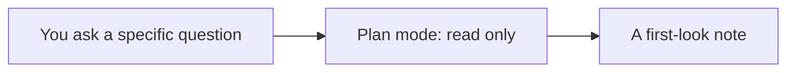

# Orientation

## After this part you can

ask Claude Code to read and explain a repo without changing it.

## You leave with

a first-look note that names one real fault and shows what you saw.

## The problem

Before you let an agent change anything, you need to see what it sees. Claude Code can read a repo, a file or a screenshot and explain it, with no edits. A vague question gets a vague answer, so you learn to ask about one file and one fault. For example, ask what is wrong with one named file.

The setup steps are in [Set up](../../00-orientation/README.md).

## What you build

| Step | Minutes | What Claude Code makes for you | The check reads |
|---|---|---|---|
| `meet-the-world` | 10 | A first-look note | The note names one of the five faults, points at a file with @, shows a screenshot, and says plan mode |

## Watch and read

| Kind | Title | Who made it | Why it is here | Link |
|---|---|---|---|---|
| video | Claude Code best practices for agentic coding | Anthropic, conference talk | The team that builds Claude Code shows how to ask well | https://www.youtube.com/watch?v=gv0WHhKelSE |
| video | Claude Code best practices webinar | Anthropic, webinar | A walk through the habits Anthropic teaches | https://claude.com/resources/webinars/claude-code-best-practices-lightspeed |
| read | Overview | Anthropic, official docs | What Claude Code is and what it can read | https://code.claude.com/docs/en/overview |
| read | Common workflows | Anthropic, official docs | Plan mode and asking about a codebase | https://code.claude.com/docs/en/common-workflows |

## Project

Ask Claude Code to explain one real file of yours, in plan mode, and write what it got right and wrong.
