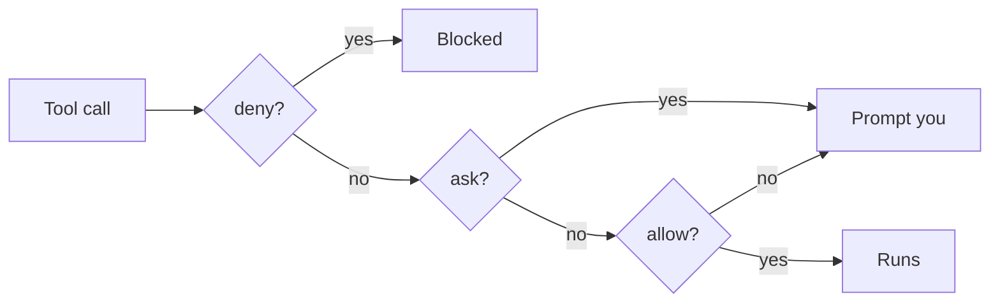

# Write the deny rules

## The problem

The agent works in `tallowmark-infra` and your shell points at prod. Right now nothing stops it from running
`terraform apply`, deleting a namespace or reading `.env`. Claude Code checks rules in a fixed order: deny, then ask,
then allow. A deny rule wins over everything else, at every level.



## Your challenge

Edit `.claude/settings.json` in this folder. Add deny rules so Claude Code never runs, without a person:

1. `terraform apply` and `terraform destroy`
2. `kubectl delete` and `helm uninstall`
3. a read of `.env` anywhere in the repo, and of anything under `~/.aws`

Keep the allow rules for `terraform plan` and the other read commands. The agent should look freely and change nothing.

Path forms matter in Read rules:

| You write | It means |
|---|---|
| `Read(~/.aws/**)` | under your home folder |
| `Read(//etc/secrets/**)` | an absolute path |
| `Read(/terraform/**)` | relative to the project, not the disk root |
| `Read(**/.env)` | `.env` in any folder of the project |

## Done when

- `.claude/settings.json` is valid JSON.
- A deny rule stops each of the six actions above.
- `terraform plan` is still allowed.

```bash
bun run verify write-the-deny-rules
```

Expect: `Done. All 8 rules pass.`


## If you get stuck

| What you see | Fix |
|---|---|
| `FAIL .claude/settings.json exists and is valid JSON` | JSON has no comments and no trailing commas. |
| `FAIL a deny rule stops reading .env anywhere in the repo` | `Read(.env)` only covers the top folder. Use `Read(**/.env)`. |
| `FAIL a deny rule stops reading ~/.aws` | `Read(/.aws/**)` means the project folder. Start with `~/`. |
| `FAIL terraform plan is still allowed` | A broad rule such as `Bash(terraform *)` in deny also blocks plan. |

To feel the rules, run `bun run world use write-the-deny-rules`, start Claude Code in `world/live/tallowmark-infra`,
and ask it to apply the prod plan. Then ask it to run `/usr/bin/terraform apply`. The next steps are about why the
second one is different.

## Words you will use

- **Deny rule**: a rule in `permissions.deny` that stops a tool call before it runs.
- **Bash rule**: a rule such as `Bash(terraform apply *)` that matches the command text Claude writes.
- **Prod**: production, the environment real fans buy tickets on.
