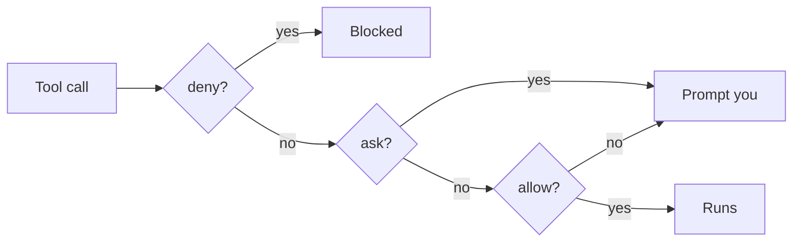

# Write the deny rules

## The problem

Claude Code works in `tallowmark-infra`, and your shell points at prod. Nothing stops it from running
`terraform apply`, deleting a namespace or reading `.env`. A deny rule is a settings line that stops a call
before it runs. Claude Code checks deny first, then ask, then allow.



## Watch it done

For example, with `Bash(terraform apply *)` in the deny list, `terraform apply -auto-approve` is stopped. The
check shows the change:

```text
Before: FAIL a deny rule stops terraform apply
After:  Done. All 8 rules pass.
```


## Your turn

1. Start Claude Code in the root folder of this course repo:

```bash
claude
```

Expect: the Claude Code prompt opens in this folder.

2. Give it the job, and ask for its plan first:

```text
Open parts/01-fence-the-agent/01-write-the-deny-rules/problem/.claude/settings.json.
Deny terraform apply, terraform destroy, kubectl delete and helm uninstall.
Also deny reading .env in any folder of the repo, and anything under ~/.aws.
Keep every allow rule. Show me your plan before you change the file.
```

Expect: a plan that lists the new deny rules.

3. Read the plan before you say yes:

- Each command rule ends in ` *`, like `Bash(terraform apply *)`.
- The `.env` rule is `Read(**/.env)`. A plain `Read(.env)` covers only the top folder.
- The allow rule `Bash(terraform plan *)` is still there.

## Do it on your work

Open the `.claude/settings.json` of a repo you own. Ask Claude Code for deny rules for its one worst command and
its one secret file. Good looks like this: the risky verb is named, and the safe look-only command still works.

## Done when

- `.claude/settings.json` is valid JSON.
- A deny rule stops each of the six actions above, and `terraform plan` is still allowed.

```bash
bun run verify write-the-deny-rules
```

Expect: `Done. All 8 rules pass.`

## Solution

The finished settings are in `../solution/.claude/settings.json`. It adds six deny rules and keeps the allow rules.
The prompts that made it are in `../solution/prompts.md`.

## If you get stuck

| What you see | What to ask Claude Code |
|---|---|
| `FAIL a deny rule stops reading .env anywhere in the repo` | "Change the .env rule to `Read(**/.env)` so it covers every folder." |
| `FAIL a deny rule stops reading ~/.aws` | "The ~/.aws rule must start with `~/`. Fix it." |
| `FAIL terraform plan is still allowed` | "A deny rule is too broad and blocks plan. Make it name the verb, like apply." |

## Go further

- `Read(/terraform/**)` means relative to the project, not the disk root.
- Run `bun run world use write-the-deny-rules`, then ask Claude Code to apply the prod plan.

## Words you will use

- **Bash rule**: a rule such as `Bash(terraform apply *)`. It matches the command text Claude Code writes.
- **Prod**: production, the place where real fans buy tickets.
