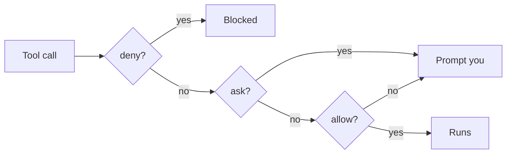
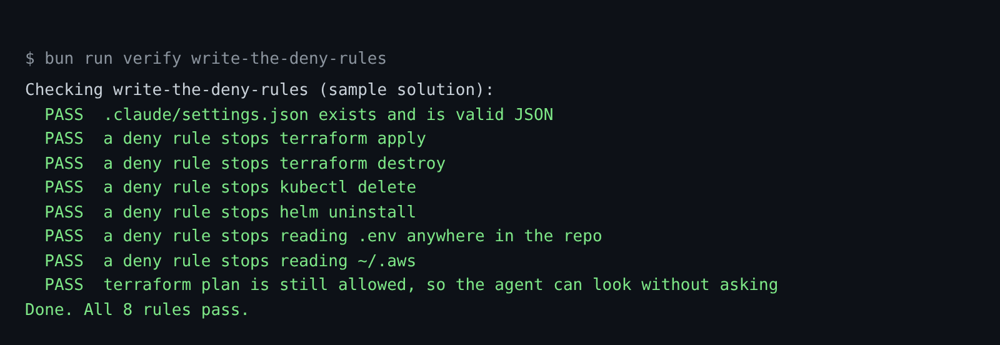

# Write the deny rules

## The problem

Claude Code works in `tallowmark-infra`, and your shell points at prod. Right now nothing stops it from running
`terraform apply`, deleting a namespace or reading `.env`.

Claude Code checks its rules in a fixed order: deny, then ask, then allow. A deny rule wins over every other rule.

For example, say Claude Code wants to run `terraform apply -auto-approve`. With the rule
`Bash(terraform apply *)` in the deny list, the call stops before it runs. Claude Code tells you it was denied.



## Your challenge

You do not write the rules. You give Claude Code the job, read its plan, and say yes or no.

Start Claude Code in the root folder of this course repo:

```bash
claude
```

Expect: the Claude Code prompt opens in this folder.

Give it this job:

```text
Open parts/01-fence-the-agent/01-write-the-deny-rules/problem/.claude/settings.json.
Add deny rules so you can never run these without a person:
terraform apply, terraform destroy, kubectl delete and helm uninstall.
Also deny reading .env in any folder of the repo, and anything under ~/.aws.
Keep every allow rule that is there now. Show me your plan before you change the file.
```

Read the plan before you say yes. Check three things:

- Each rule ends in ` *`, like `Bash(terraform apply *)`, so it covers every flag after the verb.
- The `.env` rule is `Read(**/.env)`. A plain `Read(.env)` only covers the top folder.
- The allow rule `Bash(terraform plan *)` is still there. Claude Code should look freely and change nothing.

Path forms matter in Read rules:

| The rule says | It means |
|---|---|
| `Read(~/.aws/**)` | under your home folder |
| `Read(/terraform/**)` | relative to the project, not the disk root |
| `Read(**/.env)` | `.env` in any folder of the project |

The prompts that solve this step, and the plan to look for, are in `../solution/prompts.md`. Read it after you try.

## Done when

- `.claude/settings.json` is valid JSON.
- A deny rule stops each of the six actions above.
- `terraform plan` is still allowed.

```bash
bun run verify write-the-deny-rules
```

Expect: `Done. All 8 rules pass.`



## If you get stuck

Each FAIL line has a Try next line. Give that line to Claude Code as your next prompt.

| What you see | What to ask Claude Code |
|---|---|
| `FAIL .claude/settings.json exists and is valid JSON` | "Check the settings file is valid JSON, with no comments and no trailing commas." |
| `FAIL a deny rule stops reading .env anywhere in the repo` | "Change the .env rule to `Read(**/.env)` so it covers every folder." |
| `FAIL a deny rule stops reading ~/.aws` | "The ~/.aws rule must start with `~/`. Fix it." |
| `FAIL terraform plan is still allowed` | "A deny rule is too broad and blocks plan. Make it name the verb, like apply." |

To see the rules work, run `bun run world use write-the-deny-rules`. Then ask Claude Code, in
`world/live/tallowmark-infra`, to apply the prod plan.

## Words you will use

- **Deny rule**: a rule in `permissions.deny` that stops a tool call before it runs.
- **Bash rule**: a rule such as `Bash(terraform apply *)`. It matches the command text Claude Code writes.
- **Prod**: production, the place where real fans buy tickets.
