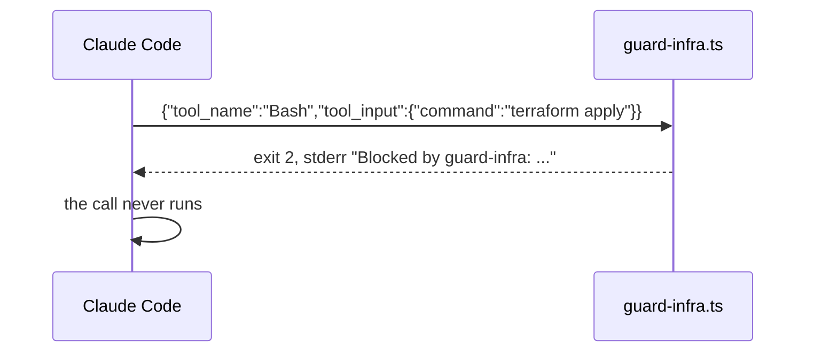
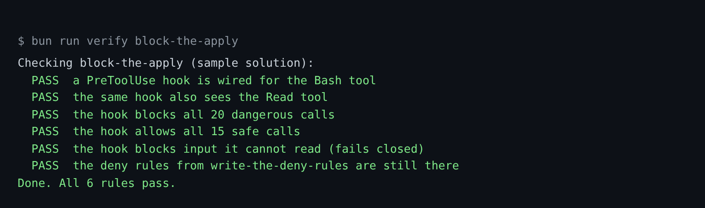

# Block the apply

## The problem

A deny rule only reads command text, so it is not a full guard. For your own logic, use a hook: a small program
Claude Code runs before each tool call. It gets the call as JSON on stdin. Exit 2 blocks and stderr is the
reason. Exit 1 does not block.



## Watch it done

For example, the starter hook lets `terraform apply` through. The finished hook blocks it:

```text
Before: d01-tf-apply: terraform apply (every hook let it through)
After:  Done. All 6 rules pass.
```



## Your turn

1. Start Claude Code in the root folder of this course repo. Give it this job:

```text
Look at parts/01-fence-the-agent/02-block-the-apply/problem/.claude/hooks/guard-infra.ts
and the settings.json next to it. Turn the hook into a guard.
Test cases are in world/guard/cases.jsonl.
Block every case with set "dangerous" (exit 2, with a reason on stderr).
Allow every case with set "safe" (exit 0).
If the input is not valid JSON, block it.
Make the hook also run for the Read, Edit and Write tools.
Keep my deny rules. Show me your plan first.
```

Expect: a plan that names exit 2 and the new matcher.

2. Read the plan before you say yes:

- It blocks with exit 2, never exit 1.
- It matches the verb, like `apply`. `terraform plan` is safe.
- It blocks when the JSON cannot be read. This is called failing closed.
- The matcher becomes `Bash|Read|Edit|Write`.

## Do it on your work

Pick one command in your own repo that must never run without you. Ask Claude Code for a hook that blocks it with
exit 2. Good looks like this: a safe call passes, and the dangerous one stops with a reason.

## Done when

- The hook matches `Bash` and `Read`.
- It blocks all 20 dangerous calls, allows all 15 safe ones, and blocks input it cannot read.
- Your deny rules are still there.

```bash
bun run verify block-the-apply
```

Expect: `Done. All 6 rules pass.` Each call that gets through is listed above its FAIL line.

## Solution

The finished hook is `../solution/.claude/hooks/guard-infra.ts`. It blocks with exit 2 and fails closed. The matcher in
`../solution/.claude/settings.json` now covers four tools. The prompts are in `../solution/prompts.md`.

## If you get stuck

| What you see | What to ask Claude Code |
|---|---|
| `FAIL the hook blocks all 20 dangerous calls` and `exit 1` in the list | "Exit 1 does not block. Use exit 2." |
| `FAIL the hook allows all 15 safe calls` | "You block safe calls. Match the verb, like apply, not the program." |
| `FAIL the same hook also sees the Read tool` | "Set the matcher to `Bash\|Read\|Edit\|Write`." |
| `FAIL ... fails closed` | "Read the JSON in a try block, and exit 2 in the catch." |

## Words you will use

- **Hook**: a program Claude Code runs at a fixed point. Here it runs before each tool call.
- **Fail closed**: when in doubt, block. Fail open lets doubtful calls through.
