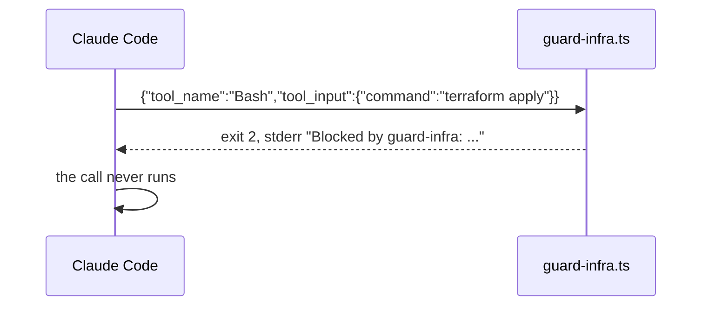

# Block the apply

## The problem

Anthropic's own docs say a Bash deny rule "covers the invocation Claude usually produces and isn't a security
boundary around the program" ([Configure permissions](https://code.claude.com/docs/en/permissions)). To decide with
your own logic, you need a PreToolUse hook: a program Claude Code runs before every matching tool call.

The contract is small. Claude Code sends the tool call as JSON on stdin. Your hook exits 2 to block it, and what you
print on stderr goes back to Claude as the reason. Exit 0 lets the normal rules decide. Exit 1 does not block: Claude
Code treats it as a hook error and runs the tool call anyway.



## Your challenge

The starter wires `.claude/hooks/guard-infra.ts` for the Bash tool, and the hook lets everything through. Make it a
guard:

1. Block the 20 dangerous calls in `world/guard/cases.jsonl` (set `dangerous`). They include applies, destroys,
   namespace deletes, Helm uninstalls, bucket deletes, a force push and two secret reads.
2. Allow the 15 safe calls (set `safe`): plan, validate, get, describe, logs, template, lint, diff, reading code.
3. Fail closed: input that is not JSON is blocked.
4. Widen the matcher so the hook also sees `Read`, `Edit` and `Write`.

Any language works. The check only reads exit codes and stdout, as Claude Code does.

## Done when

- A PreToolUse hook matches `Bash` and `Read`.
- It blocks all 20 dangerous calls and allows all 15 safe ones.
- It blocks input it cannot read.
- Your deny rules are still there.

```bash
bun run verify block-the-apply
```

Expect: `Done. All 6 rules pass.` Each call that gets through is listed by its id above its FAIL line.


## If you get stuck

| What you see | Fix |
|---|---|
| `FAIL the hook blocks all 20 dangerous calls` and `exit 1` in the list | Use `process.exit(2)`. Exit 1 is not a block. |
| `FAIL the hook allows all 15 safe calls` | Match the verb (`apply`, `delete`), not the program (`terraform`). |
| `FAIL the same hook also sees the Read tool` | Set `"matcher": "Bash\|Read\|Edit\|Write"`. |
| `FAIL ... fails closed` | Put `JSON.parse` in a try block and exit 2 in the catch. |

To try one call by hand, from the repo root:

```bash
echo '{"tool_name":"Bash","tool_input":{"command":"terraform apply"}}' | bun parts/01-fence-the-agent/02-block-the-apply/problem/.claude/hooks/guard-infra.ts; echo "exit $?"
```

Expect: `exit 2` once your hook blocks it, and `exit 0` on the starter.

## Words you will use

- **Hook**: a program Claude Code runs at a fixed point, here before each tool call.
- **PreToolUse**: the hook event that fires before a tool runs and can block it.
- **Fail closed**: when in doubt, block. The opposite, fail open, lets doubtful calls through.
- **Guard suite**: the planted calls in `world/guard/cases.jsonl`, each with a stable id.
