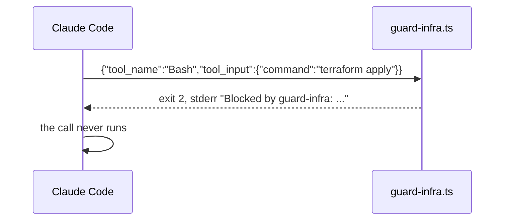

# Block the apply

## The problem

A deny rule only reads the command text. Anthropic's own docs say a Bash deny rule "covers the invocation Claude
usually produces and isn't a security boundary around the program"
([Configure permissions](https://code.claude.com/docs/en/permissions)).

To decide with your own logic, you need a hook. A PreToolUse hook is a small program. Claude Code runs it before
every matching tool call.

The deal between Claude Code and the hook is small:

- Claude Code sends the tool call to the hook as JSON on stdin.
- The hook exits 2 to block the call. What it prints on stderr goes back to Claude Code as the reason.
- Exit 0 lets the normal rules decide.
- Exit 1 does not block. Claude Code treats it as a hook error and runs the call anyway.

For example, when Claude Code wants to run `terraform apply`, the hook gets this line on stdin:
`{"tool_name":"Bash","tool_input":{"command":"terraform apply"}}`. A good hook exits 2. The apply never runs.



## Your challenge

The starter already connects `.claude/hooks/guard-infra.ts` to the Bash tool. Right now the hook lets everything
through. Your job is to get Claude Code to turn it into a guard. You write no code: you write the prompt and check
the plan.

Start Claude Code in the root folder of this course repo, and give it this job:

```text
Look at parts/01-fence-the-agent/02-block-the-apply/problem/.claude/hooks/guard-infra.ts
and the settings.json next to it. Turn the hook into a guard.
Test cases are in world/guard/cases.jsonl.
Block every case with set "dangerous" (exit 2, with a reason on stderr).
Allow every case with set "safe" (exit 0).
If the input is not valid JSON, block it.
Make the hook also run for the Read, Edit and Write tools, not only Bash.
Keep my deny rules. Show me your plan first.
```

Read the plan before you say yes. Check these points:

- It blocks with exit 2, never exit 1.
- It matches the verb, like `apply` or `delete`, not the whole program. Blocking every `terraform` call also
  blocks `terraform plan`, which is safe.
- It wraps the JSON reading in a try block, and blocks in the catch. This is called failing closed.
- The matcher in `settings.json` becomes `Bash|Read|Edit|Write`.

The prompts that solve this step are in `../solution/prompts.md`. Read them after you try.

## Done when

- A PreToolUse hook matches `Bash` and `Read`.
- It blocks all 20 dangerous calls and allows all 15 safe ones.
- It blocks input it cannot read.
- Your deny rules are still there.

```bash
bun run verify block-the-apply
```

Expect: `Done. All 6 rules pass.` Each call that gets through is listed by its id above its FAIL line.


## If you get stuck

| What you see | What to ask Claude Code |
|---|---|
| `FAIL the hook blocks all 20 dangerous calls` and `exit 1` in the list | "Exit 1 does not block. Use exit 2." |
| `FAIL the hook allows all 15 safe calls` | "You block safe calls. Match the verb, like apply, not the program." |
| `FAIL the same hook also sees the Read tool` | "Set the matcher to `Bash\|Read\|Edit\|Write`." |
| `FAIL ... fails closed` | "Read the JSON in a try block, and exit 2 in the catch." |

You can send one test call to the hook from the repo root:

```bash
echo '{"tool_name":"Bash","tool_input":{"command":"terraform apply"}}' | bun parts/01-fence-the-agent/02-block-the-apply/problem/.claude/hooks/guard-infra.ts; echo "exit $?"
```

Expect: `exit 2` once the hook blocks it, and `exit 0` on the starter.

## Words you will use

- **Hook**: a program Claude Code runs at a fixed point. Here it runs before each tool call.
- **PreToolUse**: the hook event that runs before a tool runs. It can block the tool.
- **Fail closed**: when in doubt, block. The opposite, fail open, lets doubtful calls through.
- **Guard suite**: the test calls in `world/guard/cases.jsonl`. Each one has a fixed id.
