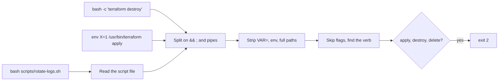

# Catch the sneaky commands

## The problem

A guard that reads command text can be walked around. In issue
[#88462](https://github.com/anthropics/claude-code/issues/88462) the permission check saw only `bash script.sh`, while the
script ran `rm -rf` on a home folder. The permissions docs list the same gap: `Bash(rm *)` stops `rm -rf build/` but not
`/bin/rm -rf build/` or `bash -c 'rm -rf build/'`.

The world repo has one of these ready: `scripts/rotate-logs.sh` says it rotates logs and ends in a prod destroy.



## Your challenge

First beat your own deny rules. Then close the gaps in the hook.

1. Read the 10 cases with set `bypass` in `world/guard/cases.jsonl`. For each, decide whether your deny rules from
   `write-the-deny-rules` would stop it. Claude Code splits `&&` and strips `env` before it matches, so be exact.
2. In `notes/deny-rule-gaps.md`, list each case id your rules miss, with one line on why.
3. Change `.claude/hooks/guard-infra.ts` so it blocks all 10, and still allows all 15 safe calls.

## Done when

- The note names at least 3 real gaps, and nothing that is not a gap.
- The hook blocks all 10 bypass forms and all 20 dangerous calls.
- It still allows all 15 safe calls and still fails closed.

```bash
bun run verify catch-the-sneaky-commands
```

Expect: `Done. All 6 rules pass.`


## If you get stuck

| What you see | Fix |
|---|---|
| `b09-script-file` gets through | Find `bash <file>` or `./<file>`, read it relative to `cwd` from the input, and check each line. Block if the file cannot be read. |
| `b03-chdir` or `b05-kubectl-context-first` gets through | Skip leading flags (and the value after `--context`) before you read the verb. |
| `b04-tofu` gets through | Treat `tofu` as `terraform`. |
| `b08-cat-credentials` gets through | Check every Bash command for secret paths, not only the Read tool. |
| `FAIL every case the note names really gets past your deny rules` | `b07` and `b10` are stopped by `Bash(terraform apply *)`, because Claude Code strips `env` and splits `&&`. |

A hook that reads text will always have gaps. That is why the next step adds the sandbox, which the operating system
enforces.

## Words you will use

- **Bypass**: a form of a dangerous command that a rule does not match.
- **Wrapper**: a program that runs another, such as `env`, `sudo`, `xargs` or `bash -c`.
- **Global flag**: a flag before the subcommand, such as `-chdir=` or `--context`.
