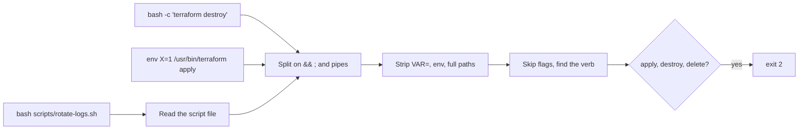

# Catch the sneaky commands

## The problem

A guard that reads command text can be tricked. In issue
[#88462](https://github.com/anthropics/claude-code/issues/88462) the permission check saw only `bash script.sh`.
The script then ran `rm -rf` on a home folder. The docs list the same gap: `Bash(rm *)` stops `rm -rf build/` but
not `/bin/rm -rf build/`.



## Watch it done

For example, `bash scripts/rotate-logs.sh` looks harmless. Its last line destroys part of prod. The check lists
what the starter misses:

```text
b04-tofu: tofu destroy -auto-approve
b09-script-file: bash scripts/rotate-logs.sh
```


## Your turn

1. Start Claude Code in the root folder. Ask it to find the gaps. The 10 cases with set `bypass` are in
`world/guard/cases.jsonl`:

```text
Read the 10 cases with set "bypass" in world/guard/cases.jsonl, and the deny rules in
parts/01-fence-the-agent/03-catch-the-sneaky-commands/problem/.claude/settings.json.
Which cases do the rules miss, and why? Write each miss, with one line on why, in problem/notes/deny-rule-gaps.md.
```

Expect: a note with at least 3 gaps. Two of the 10 are not real gaps.

2. Give it the second job:

```text
Change problem/.claude/hooks/guard-infra.ts so it blocks all 10 bypass cases too.
Split on && ; and pipes. Look inside bash -c. Strip env, VAR= and full paths.
Skip flags before the verb. Treat tofu like terraform. Read a script file it runs.
Check Bash commands for secret paths too. Keep all 15 safe cases allowed. Show me your plan first.
```

Expect: a plan that names each of those moves.

## Do it on your work

Take one deny rule from your own repo. Ask Claude Code for three ways to run that command that the rule misses.
Good looks like this: your hook blocks all three.

## Done when

- The note names at least 3 real gaps, and nothing that is not a gap.
- The hook blocks all 10 bypass forms and all 20 dangerous calls, allows all 15 safe calls, and fails closed.

```bash
bun run verify catch-the-sneaky-commands
```

Expect: `Done. All 6 rules pass.`

## Solution

The finished hook is `../solution/.claude/hooks/guard-infra.ts`. It adds the splitting, unwrapping and script
reading. See also `../solution/notes/deny-rule-gaps.md`.

## If you get stuck

| What you see | What to ask Claude Code |
|---|---|
| `b09-script-file` gets through | "Find `bash <file>`. Read the file from the `cwd` in the input, and check each line. Block if you cannot read it." |
| `b03-chdir` or `b05-kubectl-context-first` gets through | "Skip the flags before the verb, and the value after `--context`." |
| `b04-tofu` gets through | "Treat `tofu` the same as `terraform`." |
| `FAIL every case the note names really gets past your deny rules` | "b07 and b10 are stopped by `Bash(terraform apply *)`. Take them out of the note." |

## Go further

- `b08-cat-credentials`: check every Bash command for secret paths, not only the Read tool.
- A hook that reads text always has gaps, so the next step adds the sandbox.

## Words you will use

- **Bypass**: a form of a dangerous command that a rule does not match.
- **Wrapper**: a program that runs another program, such as `env`, `sudo` or `bash -c`.
