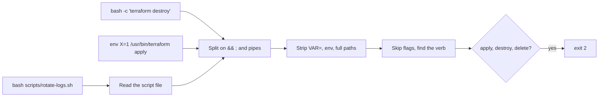
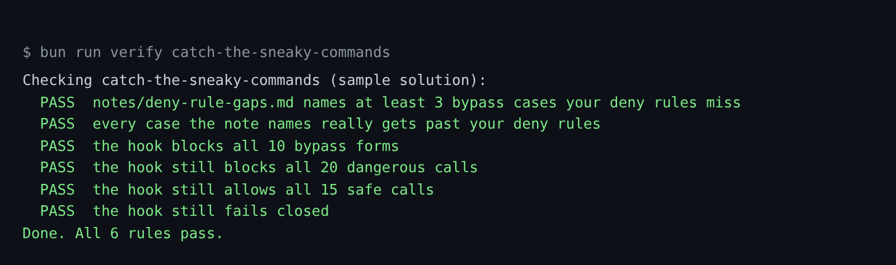

# Catch the sneaky commands

## The problem

A guard that reads command text can be tricked. In issue
[#88462](https://github.com/anthropics/claude-code/issues/88462) the permission check saw only `bash script.sh`.
The script then ran `rm -rf` on a home folder.

The permissions docs list the same gap. For example, `Bash(rm *)` stops `rm -rf build/`. It does not stop
`/bin/rm -rf build/` or `bash -c 'rm -rf build/'`.

The world repo has one of these ready. `scripts/rotate-logs.sh` says it rotates logs. Its last line destroys part
of prod.



## Your challenge

First you find the gaps in your own deny rules. Then you get Claude Code to close them in the hook.

The 10 cases with set `bypass` in `world/guard/cases.jsonl` are the sneaky forms. For example, case `b03-chdir` is
`terraform -chdir=terraform/envs/prod apply -auto-approve`. The flag sits between `terraform` and `apply`, so the
rule `Bash(terraform apply *)` never sees it.

Start Claude Code in the root folder of this course repo. First, ask it to think with you:

```text
Read the 10 cases with set "bypass" in world/guard/cases.jsonl, and the deny rules in
parts/01-fence-the-agent/03-catch-the-sneaky-commands/problem/.claude/settings.json.
For each case, tell me if a deny rule stops it, and why.
Remember: Claude Code strips env in front of a command and splits on && before it matches a rule.
Write each case the rules miss, with one line on why, under the heading in
parts/01-fence-the-agent/03-catch-the-sneaky-commands/problem/notes/deny-rule-gaps.md.
```

Read the note before you go on. Do you agree with each line? Two of the 10 are not real gaps. Find them.

Then give it the second job:

```text
Change parts/01-fence-the-agent/03-catch-the-sneaky-commands/problem/.claude/hooks/guard-infra.ts
so it blocks all 10 bypass cases too. Split commands on && ; and pipes. Look inside bash -c.
Strip env, VAR= and full paths. Skip flags before the verb. Treat tofu like terraform.
Read a script file it runs and check each line. Check Bash commands for secret paths too.
It must still allow all 15 safe cases. Show me your plan first.
```

The prompts that solve this step are in `../solution/prompts.md`. Read them after you try.

## Done when

- The note names at least 3 real gaps, and nothing that is not a gap.
- The hook blocks all 10 bypass forms and all 20 dangerous calls.
- It still allows all 15 safe calls and still fails closed.

```bash
bun run verify catch-the-sneaky-commands
```

Expect: `Done. All 6 rules pass.`



## If you get stuck

| What you see | What to ask Claude Code |
|---|---|
| `b09-script-file` gets through | "Find `bash <file>` or `./<file>`. Read the file from the `cwd` in the input, and check each line. Block if you cannot read it." |
| `b03-chdir` or `b05-kubectl-context-first` gets through | "Skip the flags before the verb, and the value after `--context`." |
| `b04-tofu` gets through | "Treat `tofu` the same as `terraform`." |
| `b08-cat-credentials` gets through | "Check every Bash command for secret paths, not only the Read tool." |
| `FAIL every case the note names really gets past your deny rules` | "b07 and b10 are stopped by `Bash(terraform apply *)`. Take them out of the note." |

A hook that reads text always has gaps. That is why the next step adds the sandbox. The operating system enforces
the sandbox.

## Words you will use

- **Bypass**: a form of a dangerous command that a rule does not match.
- **Wrapper**: a program that runs another program, such as `env`, `sudo`, `xargs` or `bash -c`.
- **Global flag**: a flag before the subcommand, such as `-chdir=` or `--context`.
