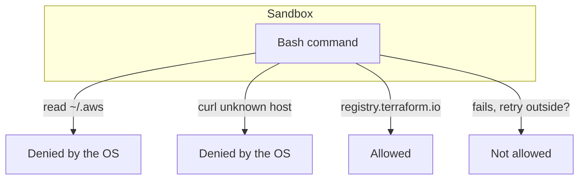
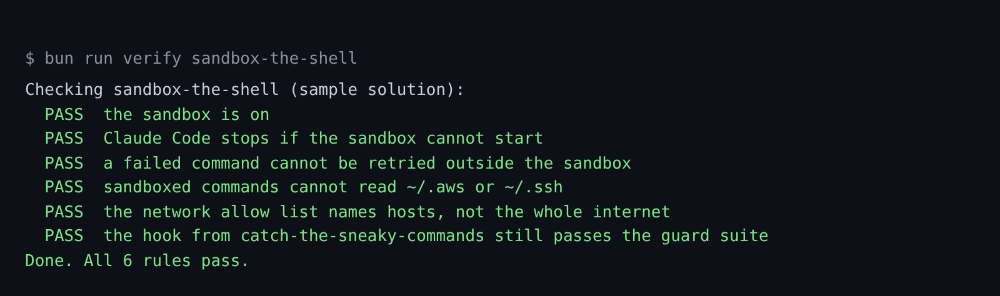

# Sandbox the shell

## The problem

Rules and hooks read command text. The sandbox does not. The operating system stops a sandboxed command from
reading a path or calling a host you did not allow. Anthropic says it cut permission prompts by 84% inside the
company ([Sandboxing](https://www.anthropic.com/engineering/claude-code-sandboxing)). By default, it can still read
`~/.aws/credentials`.



## Watch it done

For example, with `~/.aws` in the deny list, `cat ~/.aws/credentials` fails inside the sandbox, even if the text
gets past every rule and hook. The check shows the change:

```text
Before: FAIL the sandbox is on
After:  Done. All 6 rules pass.
```



## Your turn

1. Start Claude Code in the root folder of this course repo. Give it this job:

```text
Add a sandbox block to parts/01-fence-the-agent/04-sandbox-the-shell/problem/.claude/settings.json.
Turn the sandbox on, and stop Claude Code if it cannot start.
Do not let a failed command run again outside the sandbox.
Deny reads of ~/.aws, ~/.ssh and ~/.kube/prod.
Allow the network only to registry.terraform.io and registry.tallowmark.test.
Under filesystem, add "allowWrite": ["../.state", "../logs"] so the world's tools can save their records.
Keep my permissions and my hook as they are. Show me your plan first.
```

Expect: a plan with one new `sandbox` block and no change to `permissions` or `hooks`.

2. Read the plan before you say yes:

- `enabled` and `failIfUnavailable` are both `true`.
- `allowUnsandboxedCommands` is `false`. Leaving it out is not the same.
- The network list names hosts. A bare `"*"` lets a stolen key leave the machine.

## Do it on your work

Open the settings of a repo you own. Ask Claude Code to add a sandbox that denies reads of your own secret
folders and lists only the hosts the repo needs. Good looks like this: no `*`, and the escape hatch is closed.

## Done when

- `sandbox.enabled` and `sandbox.failIfUnavailable` are `true`, and `allowUnsandboxedCommands` is `false`.
- `denyRead` covers `~/.aws` and `~/.ssh`, and `allowedDomains` names hosts with no bare `*`.
- The guard suite still passes.

```bash
bun run verify sandbox-the-shell
```

Expect: `Done. All 6 rules pass.`

## Solution

The finished settings are in `../solution/.claude/settings.json`. The only change is the new `sandbox` block. The
prompts are in `../solution/prompts.md`.

## If you get stuck

| What you see | What to ask Claude Code |
|---|---|
| `FAIL Claude Code stops if the sandbox cannot start` | "Set `failIfUnavailable` to true. Without it, a machine with no sandbox runs commands with no fence." |
| `FAIL a failed command cannot be retried outside the sandbox` | "Set `allowUnsandboxedCommands` to false. Do not leave it out." |
| `FAIL the network allow list names hosts` | "Take out `*` and list each host." |

## Go further

- The sandbox needs Linux, macOS or WSL2. The check reads settings, so it passes anywhere. To see it work, start
  Claude Code in the world repo and type `/sandbox`.

## Words you will use

- **Sandbox**: a fence the operating system puts around each Bash command.
- **Escape hatch**: a failed sandboxed command can be offered a retry outside the sandbox.
