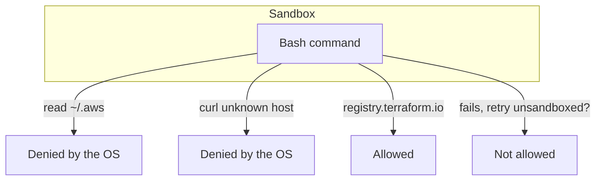

# Sandbox the shell

## The problem

Rules and hooks read command text. The sandbox does not care about text: the operating system stops a sandboxed
command from reading a path or calling a host you did not allow. Anthropic reports that inside the company,
sandboxing cut permission prompts by 84% ([Beyond permission prompts](https://www.anthropic.com/engineering/claude-code-sandboxing)),
so it adds safety and removes clicks.

By default the sandbox can still read most of the machine, including `~/.ssh` and `~/.aws/credentials`
([Sandboxing](https://code.claude.com/docs/en/sandboxing)). You have to say what it may not read.



## Your challenge

Add a `sandbox` block to `.claude/settings.json`:

1. Turn it on, and make Claude Code stop if the sandbox cannot start.
2. Close the escape hatch: a failed command may not be retried outside the sandbox.
3. Deny reads of `~/.aws` and `~/.ssh` (and `~/.kube/prod` if you like).
4. Allow network access only to the hosts the repo needs: `registry.terraform.io` for providers and
   `registry.tallowmark.test` for images.

Keep your hook. The sandbox sits under it.

## Done when

- `sandbox.enabled` and `sandbox.failIfUnavailable` are `true`.
- `sandbox.allowUnsandboxedCommands` is `false`.
- `sandbox.filesystem.denyRead` covers `~/.aws` and `~/.ssh`.
- `sandbox.network.allowedDomains` names hosts, with no bare `*`.
- The guard suite still passes.

```bash
bun run verify sandbox-the-shell
```

Expect: `Done. All 6 rules pass.`


## If you get stuck

| What you see | Fix |
|---|---|
| `FAIL Claude Code stops if the sandbox cannot start` | Without `failIfUnavailable`, a machine with no sandbox runs commands without one and says little. |
| `FAIL a failed command cannot be retried outside the sandbox` | Set `allowUnsandboxedCommands` to `false`, not leave it out. |
| `FAIL the network allow list names hosts` | `"*"` lets a stolen key leave the machine. List hosts. |

The sandbox needs Linux, macOS or WSL2. The check reads your settings, so it passes on any machine. To see it work,
start Claude Code in the world repo and run `/sandbox`.

## Words you will use

- **Sandbox**: an operating system fence around each Bash command: which paths it may read and write, which hosts it
  may reach.
- **Escape hatch**: the retry outside the sandbox that Claude Code offers when a sandboxed command fails.
- **Allow list**: the only things permitted. Anything not on it is denied.
