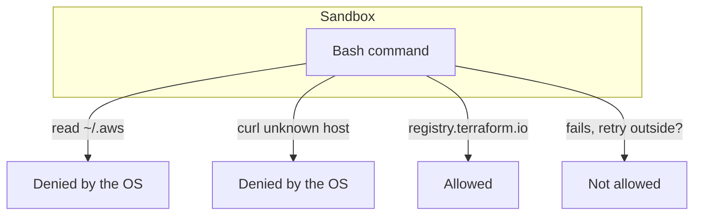

# Sandbox the shell

## The problem

Rules and hooks read command text. The sandbox does not care about text. The operating system itself stops a
sandboxed command. It cannot read a path or call a host that you did not allow.

Anthropic says that inside the company, the sandbox cut permission prompts by 84%
([Beyond permission prompts](https://www.anthropic.com/engineering/claude-code-sandboxing)). So it adds safety
and also means fewer clicks for you.

By default, the sandbox can still read most of the machine, such as `~/.ssh` and `~/.aws/credentials`
([Sandboxing](https://code.claude.com/docs/en/sandboxing)). You have to say what it may not read.

For example, with `~/.aws` in the deny list, `cat ~/.aws/credentials` fails inside the sandbox. It fails even if
the text of the command gets past every rule and hook.



## Your challenge

Get Claude Code to add a `sandbox` block to the settings. You do not write the JSON.

Start Claude Code in the root folder of this course repo, and give it this job:

```text
Add a sandbox block to parts/01-fence-the-agent/04-sandbox-the-shell/problem/.claude/settings.json.
Turn the sandbox on, and stop Claude Code if the sandbox cannot start.
Do not let a failed command run again outside the sandbox.
Deny reads of ~/.aws, ~/.ssh and ~/.kube/prod.
Allow the network only to registry.terraform.io and registry.tallowmark.test.
Under filesystem, add "allowWrite": ["../.state", "../logs"] so the world's tools can save their records.
Keep my permissions and my hook as they are. Show me your plan first.
```

Read the plan before you say yes. Check these points:

- `enabled` and `failIfUnavailable` are both `true`.
- `allowUnsandboxedCommands` is set to `false`. Leaving it out is not the same.
- The network list names hosts. A bare `"*"` lets a stolen key leave the machine.
- The `permissions` block and the `hooks` block did not change.

The prompts that solve this step are in `../solution/prompts.md`. Read them after you try.

## Done when

- `sandbox.enabled` and `sandbox.failIfUnavailable` are `true`.
- `sandbox.allowUnsandboxedCommands` is `false`.
- `sandbox.filesystem.denyRead` covers `~/.aws` and `~/.ssh`.
- `sandbox.network.allowedDomains` names hosts, with no bare `*`.
- The guard suite still passes.

```bash
bun run verify sandbox-the-shell
```

Expect: `Done. All 6 rules pass.`


## If you get stuck

| What you see | What to ask Claude Code |
|---|---|
| `FAIL Claude Code stops if the sandbox cannot start` | "Set `failIfUnavailable` to true. Without it, a machine with no sandbox runs commands with no fence." |
| `FAIL a failed command cannot be retried outside the sandbox` | "Set `allowUnsandboxedCommands` to false. Do not leave it out." |
| `FAIL the network allow list names hosts` | "Take out `*` and list each host." |

The sandbox needs Linux, macOS or WSL2. The check reads your settings, so it passes on any machine. To see the
sandbox work, start Claude Code in the world repo and type `/sandbox`.

## Words you will use

- **Sandbox**: a fence that the operating system puts around each Bash command. It says which paths the command may
  read and write, and which hosts it may reach.
- **Escape hatch**: when a sandboxed command fails, Claude Code can offer to run it again outside the sandbox.
- **Allow list**: the only things that are allowed. Anything not on it is denied.
