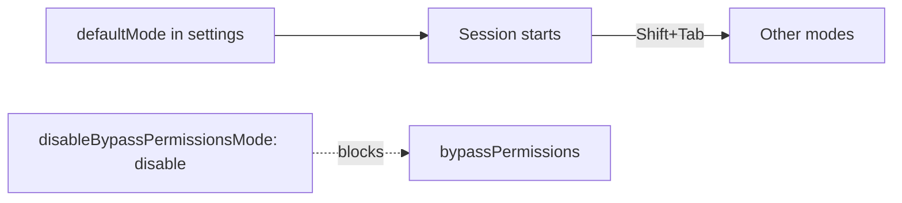

# Choose the permission mode

## The problem

The permission mode decides who says yes to each action. In auto mode, a classifier says yes for you, and
Anthropic's tests found it missed 17% of actions that went too far
([auto mode](https://www.anthropic.com/engineering/claude-code-auto-mode)). Bypass mode skips almost every
prompt. Neither belongs on a repo whose shell starts on prod.



## Watch it done

For example, in default mode Claude Code asks before it first runs `kubectl rollout restart`. In bypass mode it
runs it and does not ask. The check shows the change:

```text
Before: FAIL permissions.defaultMode is set
After:  Done. All 10 rules pass.
```


## Your turn

1. Start Claude Code in the root folder of this course repo. Ask it to learn the modes:

```text
Read https://code.claude.com/docs/en/permission-modes.
Fill in the table in parts/01-fence-the-agent/05-choose-the-permission-mode/problem/notes/permission-mode.md.
For each mode (default, acceptEdits, plan, auto, dontAsk), say what it does and when I would use it
on tallowmark-infra. Do not fill in the Mode: line yet.
```

Expect: a table with five filled rows.

2. Pick a mode. Give the second job, with your mode in place of `default`:

```text
In the same note, under "## This repo", write "Mode: default".
In problem/.claude/settings.json, set permissions.defaultMode to "default",
and permissions.disableBypassPermissionsMode to "disable".
Keep the hook and the sandbox. Show me your plan first.
```

Expect: a plan that changes only `permissions` and the note.

3. Undo a bad edit. Ask `Tidy scratch/replicas.yaml. Make it replicas: 0.` Read the diff. Let it happen, press
Esc, run `/rewind`, and choose the point before the edit. Then write `notes/undo-log.md` with the headings "The bad
edit" (paste the diff) and "How I got it back".

Expect: `scratch/replicas.yaml` shows `replicas: 3` again.

## Do it on your work

Open the settings of a repo you own. Set `defaultMode` to `default` or `plan`, and switch bypass off. Good looks
like this: you can say why that mode fits the place your shell points at.

## Done when

- The note has a filled row for each of the five modes, and its `Mode:` line matches the setting.
- `permissions.defaultMode` is set, not `auto` or `bypassPermissions`, and bypass is `"disable"`.
- The hook and the sandbox are still in place.
- `scratch/replicas.yaml` is back to `replicas: 3`, and `notes/undo-log.md` shows the diff.
- The note ends with When it goes wrong: review a diff, Esc, `/rewind`, and `/clear`.

```bash
bun run verify choose-the-permission-mode
```

Expect: `Done. All 10 rules pass.`

## Solution

The finished settings are in `../solution/.claude/settings.json`. They add `defaultMode` and the bypass switch. The
notes are in `../solution/notes/`. The prompts are in `../solution/prompts.md`.

## If you get stuck

| What you see | What to ask Claude Code |
|---|---|
| `FAIL ... a filled row for each of the five modes` | "Each row needs text in both cells after the mode name." |
| `FAIL the repo does not start in auto or bypassPermissions mode` | "Claude Code ignores those two modes in project settings. Use default or plan." |
| `FAIL the note's This repo section names the same mode` | "Write exactly `Mode: default` on its own line." |

## Words you will use

- **Permission mode**: the rule for which tool calls run without asking you.
- **Classifier**: a model that judges each action. It is a review, not a rule.
