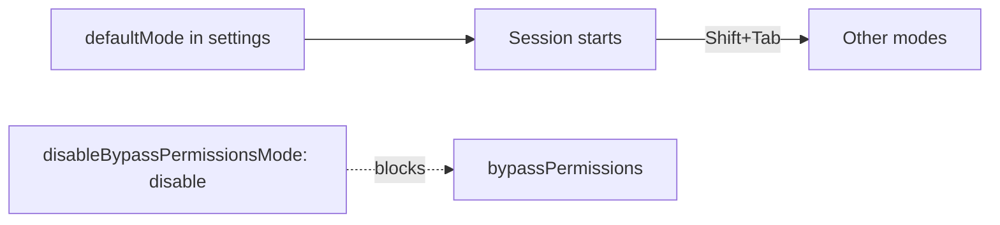
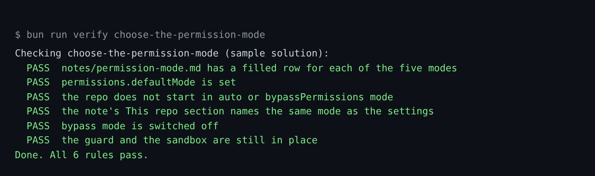

# Choose the permission mode

## The problem

The permission mode decides who says yes to each action. There are a few modes:

- In auto mode, a classifier says yes for you. Anthropic's own tests found it missed 17% of real actions that went
  too far ([How we built Claude Code auto mode](https://www.anthropic.com/engineering/claude-code-auto-mode)).
- Bypass mode skips almost every prompt.

Neither one belongs on a repo whose shell starts on prod.

In a session, press Shift+Tab to move to the next mode. The [ways of working](../../../../00-orientation/ways-of-working.md) page lists the other techniques.

For example, in default mode Claude Code asks you before it runs `kubectl rollout restart` for the first time. In
bypass mode it runs the command and does not ask.



## Your challenge

First you learn the modes with Claude Code. Then you pick one, and Claude Code writes it into the settings.

Start Claude Code in the root folder of this course repo, and give it this job:

```text
Read https://code.claude.com/docs/en/permission-modes.
Then fill in the table in
parts/01-fence-the-agent/05-choose-the-permission-mode/problem/notes/permission-mode.md.
For each mode (default, acceptEdits, plan, auto, dontAsk), say what it does,
and when I would use it on tallowmark-infra, where the shell starts on prod.
Do not fill in the Mode: line yet.
```

Read the table. Do you agree with each row? Ask Claude Code about any row you do not understand.

Now pick the mode for this repo. Then give the second job, with your mode in place of `default`:

```text
In the same note, under "## This repo", write "Mode: default".
In parts/01-fence-the-agent/05-choose-the-permission-mode/problem/.claude/settings.json,
set permissions.defaultMode to "default", and set
permissions.disableBypassPermissionsMode to "disable".
Keep the hook and the sandbox as they are. Show me your plan first.
```

The prompts that solve this step are in `../solution/prompts.md`. Read them after you try.

## Done when

- The note has a filled row for each of the five modes.
- `permissions.defaultMode` is set, and is not `auto` or `bypassPermissions`.
- The note's `Mode:` line matches the setting.
- `disableBypassPermissionsMode` is `"disable"`.
- The hook and the sandbox are still in place.
- A last section, When it goes wrong, says how you review a diff, stop with Esc, go back with `/rewind` and start fresh with `/clear`.

```bash
bun run verify choose-the-permission-mode
```

Expect: `Done. All 7 rules pass.`



## If you get stuck

| What you see | What to ask Claude Code |
|---|---|
| `FAIL ... a filled row for each of the five modes` | "Each row needs text in both cells after the mode name." |
| `FAIL the repo does not start in auto or bypassPermissions mode` | "Claude Code ignores those two modes in project settings. Use default or plan." |
| `FAIL the note's This repo section names the same mode` | "Write exactly `Mode: default` on its own line." |

## Words you will use

- **Permission mode**: the rule for which tool calls run without asking you.
- **Classifier**: a model that judges each action. It is a review, not a rule.
- **Project settings**: the file `.claude/settings.json`. Everyone who clones the repo gets it.
