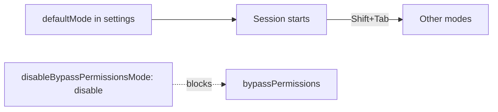

# Choose the permission mode

## The problem

The permission mode decides who approves what. Auto mode hands approval to a classifier, and Anthropic's own testing
found it missed 17% of real overeager actions
([How we built Claude Code auto mode](https://www.anthropic.com/engineering/claude-code-auto-mode)). Bypass mode skips
prompts almost entirely. Neither belongs on a repo whose shell starts on prod.



## Your challenge

1. Fill in `notes/permission-mode.md`: for each of `default`, `acceptEdits`, `plan`, `auto` and `dontAsk`, say what it
   does and when you would use it on `tallowmark-infra`. Read
   [Permission modes](https://code.claude.com/docs/en/permission-modes) first.
2. Under `## This repo`, write `Mode:` and the mode you pick for this repo.
3. Set the same mode as `permissions.defaultMode` in `.claude/settings.json`.
4. Switch bypass mode off for this repo with `permissions.disableBypassPermissionsMode`.

## Done when

- The note has a filled row for each of the five modes.
- `permissions.defaultMode` is set, and is not `auto` or `bypassPermissions`.
- The note's `Mode:` line matches the setting.
- `disableBypassPermissionsMode` is `"disable"`.
- The hook and the sandbox are still in place.

```bash
bun run verify choose-the-permission-mode
```

Expect: `Done. All 6 rules pass.`


## If you get stuck

| What you see | Fix |
|---|---|
| `FAIL ... a filled row for each of the five modes` | Each row needs text in both cells after the mode name. |
| `FAIL the repo does not start in auto or bypassPermissions mode` | Claude Code ignores those two in project settings anyway. Pick `default` or `plan`. |
| `FAIL the note's This repo section names the same mode` | Write exactly `Mode: default` (or your mode) as its own line. |

## Words you will use

- **Permission mode**: the rule for which tool calls run without asking you.
- **Classifier**: a model that judges each action. It is a review, not a rule.
- **Project settings**: `.claude/settings.json`, shared with everyone who clones the repo.
