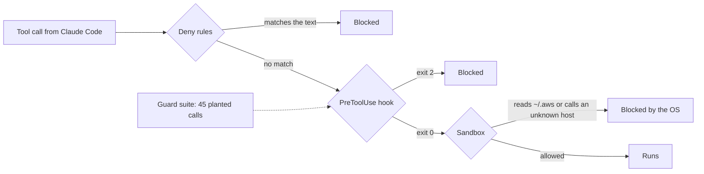

# Fence the agent

This part moves the **Objective**: you can prove Claude Code cannot apply, delete or read a secret.

## After this part you can

prove Claude Code cannot apply, delete or read a secret.

## You leave with

deny rules, a guard hook, a sandbox, a permission mode, and an undo log from one bad edit you rewound.

## The problem

A Claude Code session that runs with no prompts can do real damage in one tool call. For example, in issue
[#93099](https://github.com/anthropics/claude-code/issues/93099) a session cleaned up after its tests. Edits were
accepted with no prompt. It ran `rm -rf "$HOME"` and deleted 57,235 files and 11,315 folders.

Asking the person each time is not a guard either. Anthropic says that people accept 93% of permission prompts
([How we built Claude Code auto mode](https://www.anthropic.com/engineering/claude-code-auto-mode)).

At Tallowmark Tickets, Claude Code works in `tallowmark-infra`, and the shell starts on prod. One
`terraform destroy` deletes the buyer records. One `kubectl delete ns seat` means no fan can buy a ticket.

A line in a prompt does not fix this. You need layers that do not depend on what Claude Code decides. You also need
a test that proves each layer works.

In every step you write no code. You give Claude Code the job in plain English, read its plan, and say yes or no.
Claude Code writes the settings, the hook and the notes.



## Watch and read

| Kind | Title | Who made it | Why it is here | Link |
|---|---|---|---|---|
| video | Claude Code best practices for agentic coding | Anthropic, conference talk | The team that builds Claude Code shows the habits that keep agents safe and useful | https://www.youtube.com/watch?v=gv0WHhKelSE |
| video | Building effective agents | Anthropic, conference talk | Why a person stays in the loop, from the people who run agents in production | https://www.youtube.com/watch?v=D7_ipDqhtwk |
| read | Permissions | Anthropic, official docs | The rule syntax this part's deny rules use | https://code.claude.com/docs/en/permissions |
| read | Hooks reference | Anthropic, official docs | Exact exit codes and JSON a guard hook must return | https://code.claude.com/docs/en/hooks |
| read | Sandboxing | Anthropic, official docs | What the operating system blocks no matter what the agent says | https://code.claude.com/docs/en/sandboxing |
| read | How we built Claude Code auto mode | Anthropic, engineering blog | The numbers behind why prompts and classifiers are not a fence | https://www.anthropic.com/engineering/claude-code-auto-mode |

## Project

Put three deny rules and the guard hook on one real repo of yours. Run the guard suite and keep its counts.

## What you build

| Step | Minutes | What Claude Code makes for you | The check reads |
|---|---|---|---|
| `write-the-deny-rules` | 10 | Deny rules in `.claude/settings.json` | Your settings, matched the way Claude Code matches rules |
| `block-the-apply` | 20 | A PreToolUse hook, wired in settings | The hook's exit code and JSON on 20 dangerous and 15 safe planted calls |
| `catch-the-sneaky-commands` | 15 | A hook that also stops 10 bypass forms, and a note of your deny rule gaps | The hook on 45 calls, and your gaps against your own rules |
| `sandbox-the-shell` | 15 | A sandbox block in settings | Your sandbox keys, and the guard suite again |
| `choose-the-permission-mode` | 15 | A permission mode and a note on when to use each one | Your settings and the note |

Every step starts from the last step's sample answer. So you can start any step fresh.

## Walkthrough

Point the world repo at a step's work, so a real Claude Code session in the world uses your settings and hook:

```bash
bun run world use write-the-deny-rules
```

Expect: `The world repo now uses parts/01-fence-the-agent/01-write-the-deny-rules/problem/.claude as its .claude folder.`

To check your work, ask Claude Code. For example, for the step you just finished:

```text
Check my work for this step. Run its check and tell me what it printed. Do not change anything to make it pass.
```

You can also run the checks yourself:

Check each step in order. Each prints PASS or FAIL lines, and a Try next line under every FAIL.

```bash
bun run verify write-the-deny-rules
bun run verify block-the-apply
bun run verify catch-the-sneaky-commands
bun run verify sandbox-the-shell
bun run verify choose-the-permission-mode
```

Expect: `Done. All 8 rules pass.`, then 6, 6, 6 and 10 rules, once each step is solved.

Check the whole part in one go, and see the board count the guard suite:

```bash
bun run verify part fence-the-agent
bun run board
```

Expect: `Part fence-the-agent is done: 5/5 steps pass.` and Dangerous actions blocked:   30 of 30.
