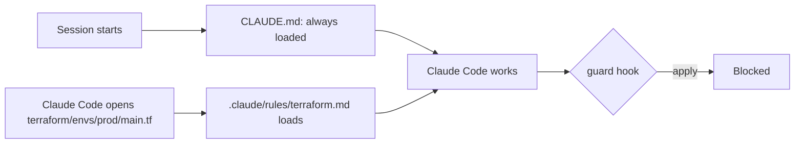
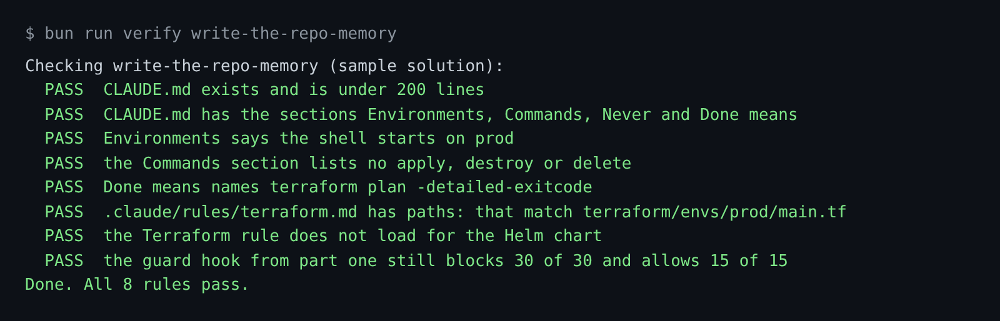

# Write the repo memory

## The problem

Each Claude Code session starts with an empty memory. It does not know that your shell starts on prod. It does
not know that `plan` is the judge of done.

`CLAUDE.md` is the file Claude Code reads at the start of every session. Rules in `.claude/rules/` load only
when Claude Code opens a matching file. The docs say to keep `CLAUDE.md` under 200 lines. Longer files are
followed less well.

But memory is advice, not a guard. For example, many people report that Claude Code skipped a "mandatory" rule
in their `CLAUDE.md` ([issue #2544](https://github.com/anthropics/claude-code/issues/2544)). So the hook from
part one stays. The memory tells Claude Code how to work. The hook stops what it must never do.



## Your challenge

Start Claude Code in the root folder of this course repo, and give it this job:

```text
Read world/seed/tallowmark-infra: its README, .envrc, terraform/, charts/ and alerts/.
Then write parts/02-teach-the-repo/01-write-the-repo-memory/problem/CLAUDE.md for that repo.
Use exactly four sections: Environments, Commands, Never, Done means.
Say that the shell starts on prod. List only commands that read, never apply.
Done means: terraform plan -detailed-exitcode exits 0 after a person applies.
Keep it under 60 lines. Show me the file before you save it.
```

Read the file. Is every line a fact Claude Code needs in every session? Cut the rest.

Then give the second job:

```text
Move the Terraform-only advice into
parts/02-teach-the-repo/01-write-the-repo-memory/problem/.claude/rules/terraform.md,
with front matter paths: ["terraform/**/*.tf"].
Say the code is the source of truth, and that the buyer records bucket keeps
versioning on and all four public access settings true.
Do not touch .claude/settings.json or the hook.
```

The prompts that solve this step are in `../solution/prompts.md`. Read them after you try.

## Done when

- `CLAUDE.md` is under 200 lines, with the sections Environments, Commands, Never and Done means.
- The Commands section has no apply, destroy or delete.
- Done means names `terraform plan -detailed-exitcode`.
- `.claude/rules/terraform.md` loads for `terraform/envs/prod/main.tf`, and not for the Helm chart.
- The guard hook from part one still blocks 30 of 30 and allows 15 of 15.

```bash
bun run verify write-the-repo-memory
```

Expect: `Done. All 8 rules pass.`



## If you get stuck

| What you see | What to ask Claude Code |
|---|---|
| `FAIL CLAUDE.md exists and is under 200 lines` | "Cut every line that is not needed in every session. Move Terraform detail to the rule file." |
| `FAIL .claude/rules/terraform.md has paths: ...` | "Use `terraform/**/*.tf`. The pattern `terraform/*.tf` only matches files directly in terraform/." |
| `FAIL the guard hook from part one still blocks 30 of 30 ...` | "Put back the hooks block in settings.json and the file .claude/hooks/guard-infra.ts." |

## Words you will use

- **Memory**: `CLAUDE.md`, the text Claude Code reads at the start of each session.
- **Path-scoped rule**: a file in `.claude/rules/` with `paths:` at the top. It loads only for matching files.
- **Front matter**: the lines between two `---` lines at the top of a Markdown file.
