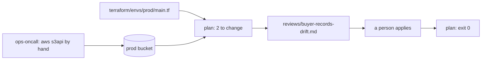
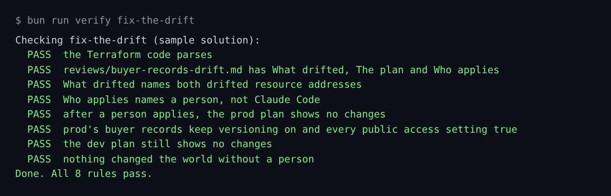

# Fix the drift

## The problem

Someone on call changed prod by hand. They used the AWS CLI on the buyer records bucket. They switched off
versioning and removed the public access block. That bucket holds buyer names, emails and payment references.

A change made outside the code is called drift. Datadog found that at least 38 percent of organizations still
change production in the console ([State of DevSecOps](https://www.datadoghq.com/state-of-devsecops-2025/)).

For example, run the prod plan in your world. It wants to change two resources that nobody touched in the code:

```bash
bun run world reset
world/bin/terraform -chdir=world/live/tallowmark-infra/terraform/envs/prod plan -detailed-exitcode
```

Expect: `Plan: 0 to add, 2 to change, 0 to destroy.` The exit code is 2, which means "there are changes".

There are two ways to make the plan quiet. One puts prod back the way the code says. The other copies the hand
change into the code, and leaves the bucket open. Only the first one is a fix.



## Your challenge

Claude Code finds the drift and writes the note. It does not apply. Start Claude Code in the root folder of
this course repo, and give it this job:

```text
Prod's buyer records bucket has drifted. Find out how, and do not change anything.
Run world/bin/terraform -chdir=world/live/tallowmark-infra/terraform/envs/prod plan
and read world/live/logs/commands.jsonl to see who changed it.
The Terraform code is the source of truth. If the code is right, leave
parts/02-teach-the-repo/02-fix-the-drift/problem/terraform/envs/prod/main.tf as it is.
Write parts/02-teach-the-repo/02-fix-the-drift/problem/reviews/buyer-records-drift.md
with the sections What drifted, The plan, and Who applies.
Name every resource address the plan wants to change. A person applies, not you.
Show me your plan first.
```

Read its plan before you say yes. If it wants to edit `main.tf` to say `Suspended`, say no.

The check plays the person. It applies your code on a fresh drifted world, then plans again.

The prompts that solve this step are in `../solution/prompts.md`. Read them after you try.

## Done when

- The note has What drifted, The plan and Who applies.
- What drifted names `aws_s3_bucket_versioning.buyer_records` and
  `aws_s3_bucket_public_access_block.buyer_records`.
- After a person applies, the prod plan shows no changes, and the bucket is locked again.
- Nothing changed the world without a person.

```bash
bun run verify fix-the-drift
```

Expect: `Done. All 8 rules pass.`



## If you get stuck

| What you see | What to ask Claude Code |
|---|---|
| `FAIL What drifted names both drifted resource addresses` | "Copy each address from the plan output into What drifted, word for word." |
| `FAIL prod's buyer records keep versioning on ...` | "Undo your change to main.tf. The code is right. Prod is wrong." |
| `FAIL nothing changed the world without a person` | Nothing to ask. Run `bun run world reset`, and say no to any apply. |

## Words you will use

- **Drift**: the cloud no longer matches the code, because someone changed it by hand.
- **Source of truth**: the one place that says how things should be. Here it is the Terraform code.
- **`-detailed-exitcode`**: makes `plan` exit 0 for no changes, and 2 for changes.
