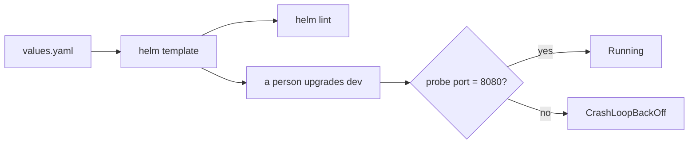
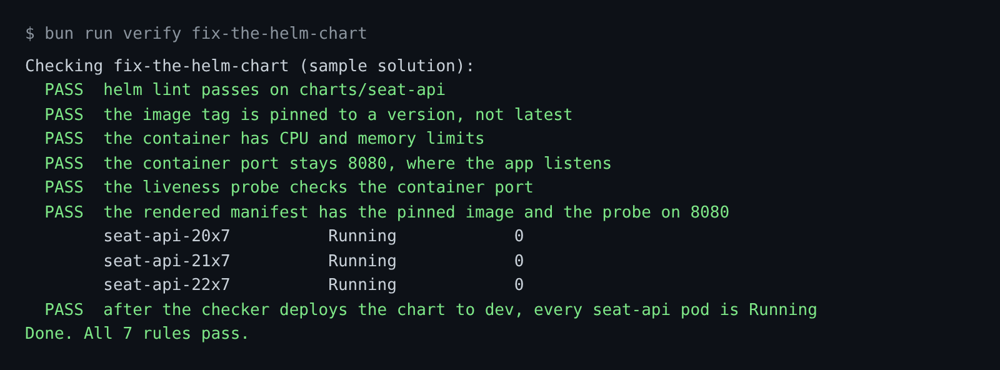

# Fix the Helm chart

## The problem

`seat-api` holds seats and takes payment. If it is down, nobody can buy a ticket. On dev it restarts again and
again. The chart in `charts/seat-api` has three faults:

- The image tag is `latest`, so a deploy can pull a different build than the one you tested.
- There are no CPU or memory limits, so one busy pod can starve the rest of the node.
- The health probe checks port 9090. The app listens on 8080. Kubernetes kills each pod as unhealthy.

For example, run these in your world:

```bash
world/bin/kubectl get pods -n seat --context kind-tallowmark-dev
world/bin/kubectl logs seat-api --context kind-tallowmark-dev
```

Expect: three `seat-api` pods in `CrashLoopBackOff`, then `listening on :8080`.

A weak fix moves the app to port 9090 to match the probe. The pods go green, but the app still listens on 8080,
and every request fails.



## Your challenge

Start Claude Code in the root folder of this course repo, and give it this job:

```text
seat-api crash-loops on dev. Find out why, and fix the chart in
parts/02-teach-the-repo/03-fix-the-helm-chart/problem/charts/seat-api.
Use world/bin/kubectl and world/bin/helm with --context kind-tallowmark-dev to look.
Read the pod logs to see which port the app listens on. Keep the app on that port.
Pin the image tag to the appVersion in Chart.yaml. Add CPU and memory requests and limits.
Then run world/bin/helm lint and world/bin/helm template on the chart.
Do not upgrade or install any release. Show me your plan first.
```

Read the plan. Which number does it change: the probe port, or the container port? Say no if it moves the app.

The check plays the person. It deploys your chart to dev in a fresh world, then reads the pods.

The prompts that solve this step are in `../solution/prompts.md`. Read them after you try.

## Done when

- `helm lint` passes.
- The image tag is a version, such as `2.7.1`.
- CPU and memory limits are set.
- The container port stays 8080, and the probe checks 8080.
- After the checker deploys the chart to dev, every `seat-api` pod is Running.

```bash
bun run verify fix-the-helm-chart
```

Expect: `Done. All 7 rules pass.`



## If you get stuck

| What you see | What to ask Claude Code |
|---|---|
| `FAIL the container port stays 8080, where the app listens` | "Put containerPort back to 8080 and move the probe to 8080." |
| `FAIL the image tag is pinned to a version, not latest` | "Use the appVersion from Chart.yaml as the tag. A name like stable can change." |
| `FAIL ... every seat-api pod is Running` | "Run helm template and show me the livenessProbe port." |

## Words you will use

- **Helm chart**: a folder of Kubernetes templates and a `values.yaml` that fills them in.
- **Liveness probe**: a check Kubernetes runs on a pod. If it fails, Kubernetes restarts the pod.
- **CrashLoopBackOff**: a pod that starts, fails, and waits longer before each new try.
