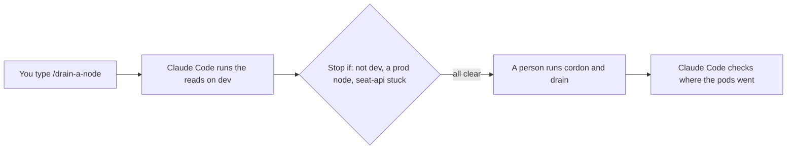

# Write a runbook skill

## The problem

Draining a node moves every pod off it. On dev that is routine. On prod it can stop ticket sales. Your shell
starts on prod, so a `kubectl drain` with no `--context` goes to prod. A skill is a folder with a `SKILL.md`. You
start it by name, and its steps stay out of `CLAUDE.md`.

## Watch it done

For example, the docs say `disable-model-invocation: true` stops Claude Code from starting a skill by itself. The
`allowed-tools` list runs tools without asking, so `Bash(kubectl *)` there would pre-approve a drain on prod.



The check on the sample answer ends like this:

```text
Done. All 8 rules pass.
```

## Your turn

1. Start Claude Code in the root folder of this course repo, and give it this job:

```text
Write a skill in
parts/02-teach-the-repo/04-write-a-runbook-skill/problem/.claude/skills/drain-a-node/SKILL.md.
It drains one node on dev only. Front matter: name drain-a-node, a one-line description,
disable-model-invocation: true, and allowed-tools that only pre-approve
kubectl get and kubectl describe with --context kind-tallowmark-dev.
Sections: Before you start, Commands Claude Code runs (reads only),
Commands a person runs (cordon, drain, uncordon), and Stop if.
Every kubectl line names --context kind-tallowmark-dev.
Show me the file before you save it.
```

Expect: the file shown to you before it is saved.

2. Read the file. Could any line touch prod? Would the guard hook block any line under "Commands Claude Code runs"?
3. To try it, run this, start `claude` in `world/live/tallowmark-infra`, and type `/drain-a-node`:

```bash
bun run world use write-a-runbook-skill
```

Expect: the skill runs only reads, then stops for a person.

## Do it on your work

Pick one routine job of yours with a fixed order. Write it as a skill the same way. Good looks like reads for
Claude Code, writes for a person, and a Stop if section.

## Done when

- The skill has a name, a description and `disable-model-invocation: true`.
- `allowed-tools` pre-approves no write on prod, and no file edits.
- Every kubectl line names `--context kind-tallowmark-dev`.
- The skill has a "Stop if" section.
- Every command Claude Code runs passes the guard hook.

```bash
bun run verify write-a-runbook-skill
```

Expect: `Done. All 8 rules pass.`


## Solution

See `../solution/`. The diff adds `.claude/skills/drain-a-node/SKILL.md`. The prompts are in
`../solution/prompts.md`. Read them after you try.

## If you get stuck

| What you see | What to ask Claude Code |
|---|---|
| `FAIL allowed-tools pre-approves no write on prod ...` | "List only `Bash(kubectl get * --context kind-tallowmark-dev)` and the same for describe." |
| `FAIL every command Claude Code runs passes the finished guard` | "Move cordon, drain and uncordon to Commands a person runs." |
| `FAIL the skill has a stop condition` | "Add a Stop if section: wrong context, a prod node, or seat-api with nowhere to go." |

## Words you will use

- **Skill**: a folder with a `SKILL.md` that Claude Code loads when you, or it, start the skill.
- **Runbook**: written steps for a routine job, in a fixed order.
- **Drain**: move every pod off a node, so the node can be worked on.
