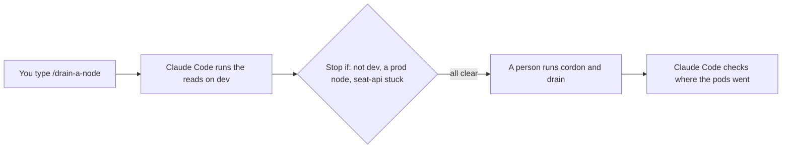
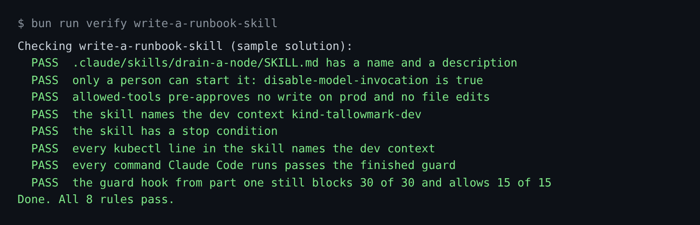

# Write a runbook skill

## The problem

Some jobs have many steps and a fixed order, such as draining a node. You do not want them in `CLAUDE.md`, where
they load into every session. A skill is a better home. It is a folder with a `SKILL.md` file. You start it by
name, such as `/drain-a-node`.

A drain moves every pod off a node. On dev that is routine. On prod it can stop ticket sales. Your shell starts
on prod. So a `kubectl drain` line with no `--context` goes to prod.

For example, the docs say `disable-model-invocation: true` stops Claude Code from starting a skill by itself. And
`allowed-tools` lists the tools that run without asking while the skill runs. `Bash(kubectl *)` there would
pre-approve `kubectl drain` on prod.



## Your challenge

Start Claude Code in the root folder of this course repo, and give it this job:

```text
Write a skill in
parts/02-teach-the-repo/04-write-a-runbook-skill/problem/.claude/skills/drain-a-node/SKILL.md.
It drains one node on dev only. Front matter: name drain-a-node, a one-line description,
disable-model-invocation: true, and allowed-tools that only pre-approve
kubectl get and kubectl describe with --context kind-tallowmark-dev.
Sections: Before you start, Commands Claude Code runs (reads only),
Commands a person runs (cordon, drain, uncordon), and Stop if.
Every kubectl line names --context kind-tallowmark-dev.
Show me the file before you save it.
```

Read the file. Could any line touch prod? Would the guard hook block any line under "Commands Claude Code runs"?

To try it in a session, run `bun run world use write-a-runbook-skill`, start `claude` in
`world/live/tallowmark-infra`, and type `/drain-a-node`.

The prompts that solve this step are in `../solution/prompts.md`. Read them after you try.

## Done when

- The skill has a name, a description and `disable-model-invocation: true`.
- `allowed-tools` pre-approves no write on prod, and no file edits.
- Every kubectl line names `--context kind-tallowmark-dev`.
- The skill has a "Stop if" section.
- Every command Claude Code runs passes the guard hook.

```bash
bun run verify write-a-runbook-skill
```

Expect: `Done. All 8 rules pass.`



## If you get stuck

| What you see | What to ask Claude Code |
|---|---|
| `FAIL allowed-tools pre-approves no write on prod ...` | "List only `Bash(kubectl get * --context kind-tallowmark-dev)` and the same for describe." |
| `FAIL every command Claude Code runs passes the finished guard` | "Move cordon, drain and uncordon to Commands a person runs." |
| `FAIL the skill has a stop condition` | "Add a Stop if section: wrong context, a prod node, or seat-api with nowhere to go." |

## Words you will use

- **Skill**: a folder with a `SKILL.md` that Claude Code loads when you, or it, start the skill.
- **Runbook**: written steps for a routine job, in a fixed order.
- **Drain**: move every pod off a node, so the node can be worked on.
