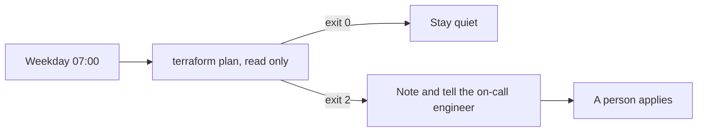

# Schedule the drift check

## The problem

Drift is when the real cloud no longer matches the code. Nobody looks until something breaks. A scheduled check
looks every morning. It must only read. It must stay quiet when all is well, or people stop reading it.

## Watch it done

For example, at 07:00 the check finds that a bucket lost versioning, and the on-call engineer sees one note.



The check on the sample answer ends like this:

```text
Done. All 7 rules pass.
```

## Your turn

1. Start Claude Code in the root folder of this course repo, and give it this job:

```text
In parts/02-teach-the-repo/05-schedule-the-drift-check/problem/routines/drift-check.toml fill every field.
Run on weekday mornings, never more often than once an hour. The prompt runs terraform plan with -detailed-exitcode
on prod, names each drifted address, and never applies. Allow only plan, show, Read and writes to reviews/.
Tell a person only when there is drift. Name the owner. Add a contract table with a turn limit, what a failed run does, and a log file. Show me the file first.
```

Expect: the file shown to you first.

2. Read it. Could any allowed tool change prod? Expect: no.

## Do it on your work

Write the same file for one of your own checks. Good looks like a fixed time, read-only tools, a named owner, and
a note only when something is wrong.

## Done when

- The schedule is five fields and runs at most once an hour.
- The prompt plans with `-detailed-exitcode` and says never to apply.
- No allowed tool applies, destroys or imports.
- It notifies only on drift, and names an owner.
- A run contract caps the turns, says what a failed run does, and names a log file.

```bash
bun run verify schedule-the-drift-check
```

Expect: `Done. All 7 rules pass.`

## Solution

See `../solution/`. The diff fills every field of `routines/drift-check.toml`. The prompts are in
`../solution/prompts.md`. Read them after you try.

## If you get stuck

| What you see | What to ask Claude Code |
|---|---|
| `FAIL the schedule runs at most once an hour` | "Use a fixed minute and hour, such as 0 7 * * 1-5." |
| `FAIL the run contract caps turns ...` | "Add [contract] with max_turns, on_failure and a .jsonl log." |
| `FAIL no allowed tool changes anything` | "Remove apply from allowed_tools. Keep plan and show." |

## Words you will use

- **Drift**: the real cloud differs from the code.
- **Cron**: five fields, minute hour day month weekday, that say when a job runs.
