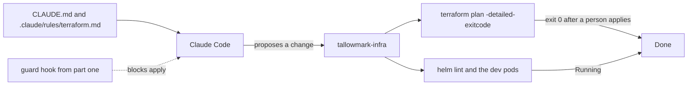

# Teach it the repo

This part moves the **Outcome**: Claude Code fixes real drift and a broken chart, with the guardrails on.

## The problem

People still change production directly, outside the code. Datadog found that at least 38 percent of organizations
make changes in the production console ([State of DevSecOps](https://www.datadoghq.com/state-of-devsecops-2025/)).

Each change made outside the code is drift. The next plan wants to undo it, or trips over it.

For example, at Tallowmark someone on call used the AWS CLI on the buyer records bucket. They switched off
versioning and removed the public access block. Also, `seat-api` restarts again and again on dev. Its health probe
points at the wrong port.

With the fence from part one in place, Claude Code can now help. It needs to know the rules of the repo. Its work is
judged by the tools that own the truth: `terraform plan` and the cluster. It is never judged by what it says.

You write no code in this part either. You tell Claude Code what the repo needs, and you check its plan.



## What you build

| Step | Minutes | What Claude Code makes for you | The check reads |
|---|---|---|---|
| `write-the-repo-memory` | 15 | `CLAUDE.md` under 200 lines and `.claude/rules/terraform.md` with `paths:` | The files' sections and line count, and that the guard hook still exists |
| `fix-the-drift` | 20 | `reviews/buyer-records-drift.md`, and the Terraform code left as the source of truth | The prod plan after the checker applies as a person, the bucket's state, and the command log for any agent change |
| `fix-the-helm-chart` | 20 | A fixed `charts/seat-api` | `helm lint`, the chart values, the rendered manifest, and the dev pods after the checker deploys |
| `write-a-runbook-skill` | 20 | `.claude/skills/drain-a-node/SKILL.md`, dev only | The skill's front matter, its `allowed-tools`, and each command it runs against the guard hook |

Every step starts from the last step's sample answer. So you can start any step fresh.

## Walkthrough

Seed the world, and put its practice tools first on your PATH:

```bash
bun run world reset
export PATH="$PWD/world/bin:$PATH"
terraform -chdir=world/live/tallowmark-infra/terraform/envs/prod plan -detailed-exitcode
```

Expect: `Plan: 0 to add, 2 to change, 0 to destroy.` This is the drift you fix in the second step.

Look at the crashing chart on dev:

```bash
kubectl get pods -n seat --context kind-tallowmark-dev
```

Expect: three `seat-api` pods in `CrashLoopBackOff`.

Now start Claude Code in this folder with `claude`, and give it the job in each step's README. Check each step
when Claude Code is done. Each prints PASS or FAIL lines, and a Try next line under every FAIL.

```bash
bun run verify write-the-repo-memory
bun run verify fix-the-drift
bun run verify fix-the-helm-chart
bun run verify write-a-runbook-skill
```

Expect: `Done. All 8 rules pass.`, then 8, 7 and 8 rules, once each step is solved.

To try your skill in a real session, point the world repo at the step's `.claude` folder:

```bash
bun run world use write-a-runbook-skill
```

Expect: `The world repo now uses parts/02-teach-the-repo/04-write-a-runbook-skill/problem/.claude as its .claude folder.`

Then run `claude` in `world/live/tallowmark-infra` and type `/drain-a-node`.

Check the whole part in one go:

```bash
bun run verify part teach-the-repo
```

Expect: `Part teach-the-repo is done: 4/4 steps pass.`

## Assignment

Someone switched off versioning on the buyer records bucket by hand. The `seat-api` chart crash-loops on dev. Your
team lead asks you to fix both with Claude Code, and to show that no agent applied anything.

Hand in a branch or pull request on your fork with `CLAUDE.md`, `.claude/rules/terraform.md`,
`reviews/buyer-records-drift.md` and the fixed `charts/seat-api/values.yaml`, in each step's `problem/` folder.

| # | Question | How it is checked |
|---|---|---|
| 1 | Is `CLAUDE.md` under 200 lines, with Environments, Commands, Never and Done means? | `bun run verify write-the-repo-memory` |
| 2 | Does the Terraform rule load for prod's `main.tf` and not for the chart? | same check |
| 3 | After a person applies, does the prod plan show no changes, with the bucket locked? | `bun run verify fix-the-drift` |
| 4 | Did no agent change the world? | same check, the command log |
| 5 | Is every `seat-api` pod Running on dev after the chart is deployed, with the app still on 8080? | `bun run verify fix-the-helm-chart` |
| 6 | Does the guard hook still block 30 of 30 and allow 15 of 15? | each check in this part |

Extension for advanced learners: finish `write-a-runbook-skill`, and make the skill stop when the node name has
`prod` in it.

## Finished

You now have a repo Claude Code understands. `CLAUDE.md` says how to work, and a path rule adds the Terraform
detail only when Claude Code opens Terraform files. Claude Code found real drift and a broken chart. `plan` and
the dev pods proved each fix, not what Claude Code said. A skill holds a runbook that only a person can start.

For example, `terraform plan -detailed-exitcode` on prod now exits 0 after a person applies, and the dev pods are
Running.

The next part, `give-it-eyes`, lets Claude Code read both clusters and the cloud bill. Its access is read-only
because the credentials say so, not because a setting asks nicely.
