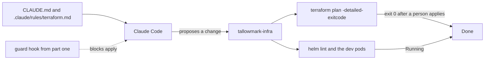

# Teach it the repo

## The problem

People still change production by hand. Datadog found that at least 38 percent of organizations make manual console
changes in production ([State of DevSecOps](https://www.datadoghq.com/state-of-devsecops-2025/)). Each hand change is
drift: the next plan wants to undo it, or trips over it. At Tallowmark someone on call switched off versioning and the
public access block on the buyer records bucket with the AWS CLI, and `seat-api` crash-loops on dev because its probe
points at the wrong port.

With the fence from part one in place, the agent can now help. It needs to know the repo's rules, and its work is
judged by the tools that own the truth: `terraform plan` and the cluster, never by what it says.

## What you build

| Step | Minutes | You produce | The check reads |
|---|---|---|---|
| `write-the-repo-memory` | 15 | `CLAUDE.md` under 200 lines and `.claude/rules/terraform.md` with `paths:` | The files' sections and line count, and that the guard hook still exists |
| `fix-the-drift` | 20 | A Terraform change or note that makes code and prod agree on the buyer records bucket | The world's plan output on prod after a person applies, and the command log for any agent apply |
| `fix-the-helm-chart` | 20 | A fixed `charts/seat-api` | The chart values, the rendered manifest, and the dev release's pods |
| `write-a-runbook-skill` | 20 | `.claude/skills/drain-a-node/SKILL.md`, dev only | The skill's front matter and the commands it lists |

## Walkthrough

TODO(part session): the commands for each step, each with an Expect: line.
