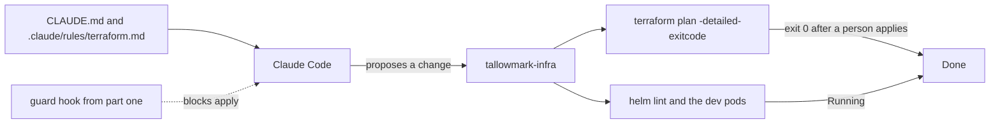

# Teach it the repo

This part moves the **Outcome**: Claude Code fixes real drift and a broken chart, with the guardrails on.

## The problem

People still change production directly, outside the code. Datadog found that at least 38 percent of organizations
make changes in the production console ([State of DevSecOps](https://www.datadoghq.com/state-of-devsecops-2025/)).

Each change made outside the code is drift. The next plan wants to undo it, or trips over it.

For example, at Tallowmark someone on call used the AWS CLI on the buyer records bucket. They switched off
versioning and removed the public access block. Also, `seat-api` restarts again and again on dev. Its health probe
points at the wrong port.

With the fence from part one in place, Claude Code can now help. It needs to know the rules of the repo. Its work is
judged by the tools that own the truth: `terraform plan` and the cluster. It is never judged by what it says.

You write no code in this part either. You tell Claude Code what the repo needs, and you check its plan.

## What you build

| Step | Minutes | What Claude Code makes for you | The check reads |
|---|---|---|---|
| `write-the-repo-memory` | 15 | `CLAUDE.md` under 200 lines and `.claude/rules/terraform.md` with `paths:` | The files' sections and line count, and that the guard hook still exists |
| `fix-the-drift` | 20 | A Terraform change or note that makes code and prod agree on the buyer records bucket | The world's plan output on prod after a person applies, and the command log for any agent apply |
| `fix-the-helm-chart` | 20 | A fixed `charts/seat-api` | The chart values, the rendered manifest, and the dev release's pods |
| `write-a-runbook-skill` | 20 | `.claude/skills/drain-a-node/SKILL.md`, dev only | The skill's front matter and the commands it lists |

## Walkthrough

TODO(part session): the commands for each step, each with an Expect: line.
