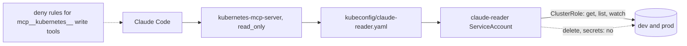
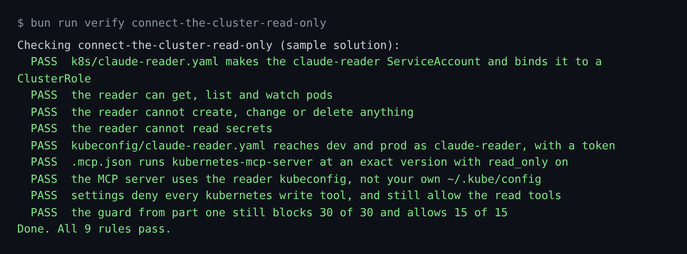

# Connect the cluster read-only

## The problem

Claude Code finds the cause of a problem faster when it can look at the clusters itself. An MCP server gives it
that view. But the view must not come with hands.

The Kubernetes MCP server has a `read_only` setting. Its own docs say this setting is "best-effort". The access
control to rely on is Kubernetes RBAC on the identity the server uses
([kubernetes-mcp-server](https://github.com/containers/kubernetes-mcp-server)).

For example, if the server uses your own `~/.kube/config`, it acts as you. One slip in the server, and
`pods_delete` runs on prod with your admin rights. If it uses a `claude-reader` account that may only `get`,
`list` and `watch`, the cluster itself says no.



## Your challenge

You give Claude Code eyes on both clusters. Three layers keep its hands off: RBAC, the server's `read_only`
setting, and deny rules in settings.

Start Claude Code in the root folder of this course repo, and give it this job:

```text
Work in parts/03-give-it-eyes/01-connect-the-cluster-read-only/problem/.
1. Write k8s/claude-reader.yaml: a ServiceAccount claude-reader in namespace ops,
   a ClusterRole that may only get, list and watch pods, pods/log, services, events,
   namespaces, nodes, configmaps, deployments, replicasets and horizontalpodautoscalers,
   and a ClusterRoleBinding. No secrets, and no "*" anywhere.
2. Write kubeconfig/claude-reader.yaml with contexts kind-tallowmark-dev and
   kind-tallowmark-prod, both using the user claude-reader with a practice token.
3. Read https://github.com/containers/kubernetes-mcp-server. Write mcp/kubernetes.toml
   with read_only = true and kubeconfig = "kubeconfig/claude-reader.yaml",
   and .mcp.json with a server named kubernetes that runs
   npx -y kubernetes-mcp-server@0.1.2 --config mcp/kubernetes.toml.
4. In .claude/settings.json, add deny rules for each kubernetes write tool:
   the delete tools, pods_exec, pods_run, resources_create_or_update,
   resources_scale, helm_install and helm_uninstall. Keep the hook as it is.
Show me your plan first.
```

Read the plan. Look hard at the ClusterRole. Does any line say `"*"`? Then ask Claude Code what the reader can do:

```bash
bun parts/03-give-it-eyes/helpers/rbac.ts parts/03-give-it-eyes/01-connect-the-cluster-read-only/problem delete pods
```

Expect: `no`

The prompts that solve this step are in `../solution/prompts.md`. Read them after you try.

## Done when

- The reader can `get`, `list` and `watch` pods, and cannot create, change or delete anything.
- The reader cannot read secrets.
- The reader kubeconfig reaches dev and prod as `claude-reader`, with a token and no admin key.
- `.mcp.json` runs `kubernetes-mcp-server` at an exact version, with `read_only` on and the reader kubeconfig.
- Settings deny every write tool of the `kubernetes` server, and still allow its read tools.
- The guard from part one still blocks 30 of 30 calls.

```bash
bun run verify connect-the-cluster-read-only
```

Expect: `Done. All 9 rules pass.`



## If you get stuck

| What you see | What to ask Claude Code |
|---|---|
| `FAIL the reader cannot create, change or delete anything` | "Replace `*` in verbs with get, list and watch. read_only does not change RBAC." |
| `FAIL the reader cannot read secrets` | "Name each resource. `*` in resources also means secrets." |
| `FAIL the MCP server uses the reader kubeconfig` | "Point kubeconfig in the TOML file at kubeconfig/claude-reader.yaml." |

## Words you will use

- **MCP server**: a program that gives Claude Code new tools, such as `pods_list`.
- **RBAC**: Kubernetes rules for who may do which verb on which resource.
- **ServiceAccount**: an identity for a program, not a person.
- **ClusterRole**: a list of allowed verbs and resources, for the whole cluster.
