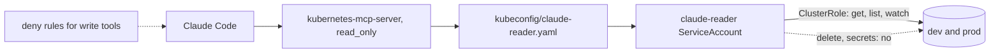

# Connect the cluster read-only

## The problem

An MCP server lets Claude Code look at the cluster. The view must not come with hands. The `read_only` setting is only "best-effort" in the server's own docs.

For example, if the server uses your `~/.kube/config`, one slip runs `pods_delete` on prod with your admin rights.

## Watch it done



With a `claude-reader` account that may only `get`, `list` and `watch`, the cluster itself says no. On the sample answer, `delete pods` prints `no` and `get pods` prints `yes`.


## Your turn

1. Start Claude Code in the root folder of this course repo. Give it this job:

```text
Work in parts/03-give-it-eyes/01-connect-the-cluster-read-only/problem/.
1. Write k8s/claude-reader.yaml: a ServiceAccount claude-reader in namespace ops,
   a ClusterRole that may only get, list and watch pods, pods/log, services, events,
   nodes, deployments and horizontalpodautoscalers, and a ClusterRoleBinding.
   No secrets, and no "*" anywhere.
2. Write kubeconfig/claude-reader.yaml with contexts kind-tallowmark-dev and
   kind-tallowmark-prod, both using the user claude-reader with a practice token.
3. Read https://github.com/containers/kubernetes-mcp-server. Write mcp/kubernetes.toml
   with read_only = true and kubeconfig = "kubeconfig/claude-reader.yaml",
   and .mcp.json with a server named kubernetes that runs
   npx -y kubernetes-mcp-server@0.1.2 --config mcp/kubernetes.toml.
4. In .claude/settings.json, add deny rules for each kubernetes write tool:
   the delete tools, pods_exec, pods_run, resources_create_or_update,
   resources_scale, helm_install and helm_uninstall. Keep the hook as it is.
Show me your plan first.
```

Expect: a plan. Does any line of the ClusterRole say `"*"`? If so, ask for a fix.

2. Ask what the reader can do:

```bash
bun checks/helpers/03-give-it-eyes/rbac.ts parts/03-give-it-eyes/01-connect-the-cluster-read-only/problem delete pods
```

Expect: `no`

## Do it on your work

Make a reader account on a cluster you own, with only `get`, `list` and `watch`. Point the MCP server at it, never at your admin file. Good looks like the cluster refusing a pod delete.

## Done when

- The reader can `get`, `list` and `watch` pods, and cannot create, change or delete anything.
- The reader cannot read secrets.
- The reader kubeconfig reaches dev and prod as `claude-reader`, with a token and no admin key.
- `.mcp.json` runs `kubernetes-mcp-server` at an exact version, with `read_only` on and the reader kubeconfig.
- Settings deny every write tool of the `kubernetes` server, and still allow its read tools.
- The guard from Fence the agent still blocks 30 of 30 calls.

```bash
bun run verify connect-the-cluster-read-only
```

Expect: `Done. All 9 rules pass.`

## Solution

The after state is in `../solution/`. It adds the reader files, `mcp/kubernetes.toml`, `.mcp.json` and the deny rules. Prompts: `../solution/prompts.md`.

## If you get stuck

| What you see | What to ask Claude Code |
|---|---|
| `FAIL the reader cannot create, change or delete anything` | "Replace `*` in verbs with get, list and watch. read_only does not change RBAC." |
| `FAIL the reader cannot read secrets` | "Name each resource. `*` in resources also means secrets." |
| `FAIL the MCP server uses the reader kubeconfig` | "Point kubeconfig in the TOML file at kubeconfig/claude-reader.yaml." |

## Words you will use

- **MCP server**: a program that gives Claude Code new tools, such as `pods_list`.
- **RBAC**: Kubernetes rules for who may do which verb on which resource.
- **ServiceAccount**: an identity for a program, not a person.
- **ClusterRole**: a list of allowed verbs and resources, for the whole cluster.
