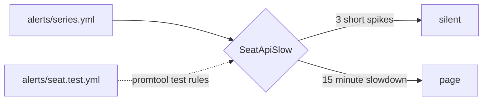
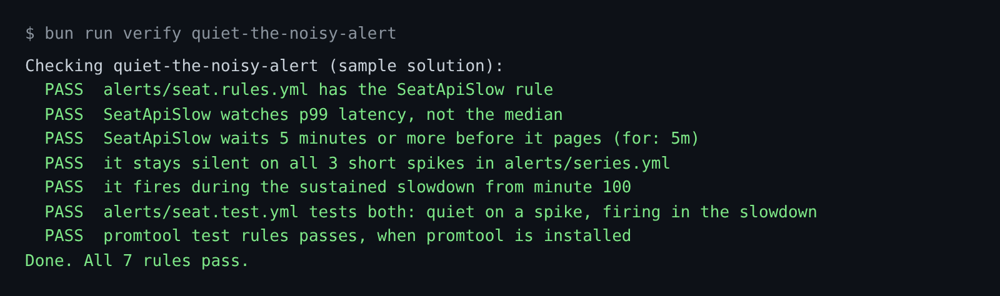

# Quiet the noisy alert

## The problem

An alert that pages for nothing teaches people to ignore pages. Then the real one gets missed.

`SeatApiSlow` in `alerts/seat.rules.yml` watches p50 latency, the median request. It has `for: 0m`, so it pages the
first minute the median goes over 0.3 seconds.

For example, `alerts/series.yml` holds what seat-api really did. There were three short spikes of one or two
minutes. Fans never noticed them, but each one paged the on-call person. Then, at minute 100, p99 sat at 2.4
seconds for 15 minutes. That slowdown cost ticket sales.

Try it on the starter:

```bash
bun parts/03-give-it-eyes/helpers/alerts.ts parts/03-give-it-eyes/02-quiet-the-noisy-alert/problem
```

Expect: four lines, and each one says `FIRES`.



## Your challenge

Claude Code reads the series and the rule, explains why it is noisy, and fixes it. It also writes a unit test, so
the next change cannot bring the noise back.

Start Claude Code in the root folder of this course repo, and give it this job:

```text
Work in parts/03-give-it-eyes/02-quiet-the-noisy-alert/problem/alerts/.
Read seat.rules.yml and series.yml. Tell me why SeatApiSlow pages on the short spikes.
Then change SeatApiSlow so it watches p99 latency over 1 second, with for: 5m.
Keep the alert name, the severity label and the group.
Then write seat.test.yml, a promtool unit test for seat.rules.yml:
100 requests a minute, normally all under 0.25 seconds; a 2 minute spike at minute 40
where 2 of 100 requests are slow; and minutes 100 to 114 where every request takes
over 1 second. Expect no alert at 42m and SeatApiSlow firing at 110m.
Show me your plan first.
```

Read the plan. Does it keep the threshold below the 2.4 seconds of the real slowdown?

The prompts that solve this step are in `../solution/prompts.md`. Read them after you try.

## Done when

- `SeatApiSlow` watches p99 latency and waits `for: 5m` or more.
- It stays silent on all 3 short spikes in `alerts/series.yml`, and fires in the slowdown.
- `alerts/seat.test.yml` expects no alert in a spike and `SeatApiSlow` in the slowdown.
- If `promtool` is installed, `promtool test rules` passes too.

```bash
bun run verify quiet-the-noisy-alert
```

Expect: `Done. All 7 rules pass.`



## If you get stuck

| What you see | What to ask Claude Code |
|---|---|
| `FAIL SeatApiSlow watches p99 latency` | "Use histogram_quantile(0.99, ...). A longer for on p50 still hides the slow tail." |
| `FAIL it stays silent on all 3 short spikes` | "Set for: 5m. The longest spike is 2 minutes." |
| `FAIL it fires during the sustained slowdown` | "The threshold is above 2.4 seconds. Bring it down to 1 second." |

## Words you will use

- **p50 and p99**: half of requests are faster than p50. 99 of 100 are faster than p99.
- **for**: how long the condition must hold before the alert fires.
- **promtool**: the Prometheus tool that checks rules and runs their unit tests.
