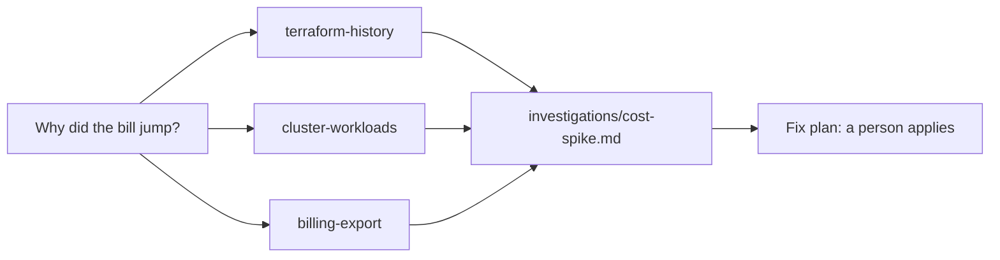
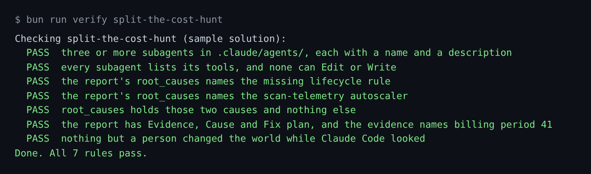

# Split the cost hunt

## The problem

Tallowmark's cloud bill doubled, and nobody meant it to. Datadog found that 83 percent of container costs come from idle resources ([State of Cloud Costs](https://www.datadoghq.com/state-of-cloud-costs/)).

The answer hides in the Terraform code, the clusters and the bill. One long session fills up with noise.

For example, `billing/cost-export.csv` shows 359.50 USD, then 717.01 USD, but not why.

## Watch it done



Three subagents each read one place and report back. The sample report names the causes:

```text
root_causes:
  - module.scan_store.aws_s3_bucket_lifecycle_configuration.scan
  - HorizontalPodAutoscaler/scan-telemetry
```



## Your turn

1. Start Claude Code in the root folder of this course repo. Give it the first job:

```text
Read https://code.claude.com/docs/en/sub-agents. In
parts/03-give-it-eyes/03-split-the-cost-hunt/problem/.claude/agents/, write three subagents:
terraform-history (terraform/ and its git history), cluster-workloads (k8s/, charts/
and kubectl get on prod) and billing-export (billing/cost-export.csv).
Each gets a name, a description and tools: Read, Grep, Glob, plus Bash where it
must run git or kubectl get. No Edit and no Write. Show me your plan first.
```

Expect: a plan, then three agent files.

2. Start a new session inside the step folder, so it loads the agents:

```bash
bun run world
export PATH="$PWD/world/bin:$PATH"
cd parts/03-give-it-eyes/03-split-the-cost-hunt/problem
claude --add-dir ../../../../world/live/tallowmark-infra
```

Expect: Claude Code starts, and `/agents` lists the three agents.

3. Give it the second job:

```text
The cloud bill jumped. The repo is ../../../../world/live/tallowmark-infra.
Run the three subagents at the same time. Change nothing in the world. Then write
investigations/cost-spike.md with front matter root_causes (resource addresses, or
Kind/name for Kubernetes objects), and the sections Evidence, Cause and Fix plan.
Name the billing period and the costs before and after. The fix plan is for a person to apply.
```

Expect: `investigations/cost-spike.md`, and no change in the world. Then `/exit` and `cd ../../../..`.

## Do it on your work

Pick one question on your project that spans two or three places, such as a slow deploy. Make one read-only subagent per place, each with a `tools` line. Good looks like one report with evidence from each place, and nothing changed.

## Done when

- Three subagents list their tools, and none can use Edit or Write.
- `root_causes` names the two real causes and nothing else.
- The report has Evidence, Cause and Fix plan, and the evidence names billing period 41.
- Nothing but a person changed the world.

```bash
bun run verify split-the-cost-hunt
```

Expect: `Done. All 7 rules pass.`

## Solution

The after state is in `../solution/`. It adds the three agents and `investigations/cost-spike.md`. Prompts: `../solution/prompts.md`.

## If you get stuck

| What you see | What to ask Claude Code |
|---|---|
| `FAIL every subagent lists its tools` | "Add a tools line. With no tools line, an agent gets every tool." |
| `FAIL ... names the missing lifecycle rule` | "Why does scan-archive-storage grow every period? Read the scan-store module." |
| `FAIL nothing but a person changed the world` | "Undo nothing. Write the change in the Fix plan." Then run `bun run world reset`. |

## Words you will use

- **Subagent**: a helper with its own context and its own tools. It reports back to the main session.
- **Autoscaler**: a Kubernetes object that sets how many pods run.
- **Lifecycle rule**: a bucket setting that deletes old files after a number of days.
