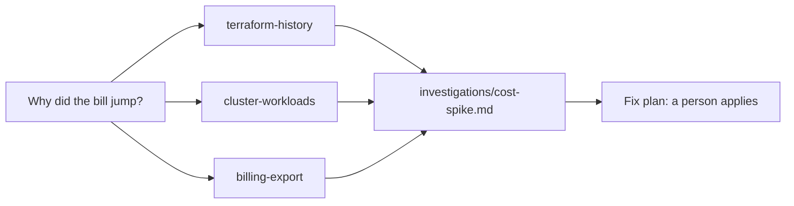

# Split the cost hunt

## The problem

Tallowmark's cloud bill doubled, and nobody changed anything on purpose. Datadog found that 83 percent of
container costs come from idle resources ([State of Cloud Costs](https://www.datadoghq.com/state-of-cloud-costs/)).

The answer is spread over three places: the Terraform code, the clusters and the bill. One long session that reads
all three fills up with noise. Three subagents can each read one place and report back.

For example, `billing/cost-export.csv` shows the total go from 359.50 USD in billing period 40 to 717.01 USD in
period 41. The bill alone does not say why.



## Your challenge

Claude Code makes three read-only subagents. Then it sends them out at the same time and writes one report. It
fixes nothing. A person applies the fix later.

Start Claude Code in the root folder of this course repo, and give it the first job:

```text
Read https://code.claude.com/docs/en/sub-agents. In
parts/03-give-it-eyes/03-split-the-cost-hunt/problem/.claude/agents/, write three subagents:
terraform-history (reads terraform/ and its git history), cluster-workloads (reads k8s/,
charts/ and kubectl get on prod) and billing-export (reads billing/cost-export.csv).
Each one gets a name, a description and tools: Read, Grep, Glob, plus Bash where it
must run git or kubectl get. No Edit and no Write. Show me your plan first.
```

Then start a new session inside the step folder, so it loads the three agents. It reads the world repo too:

```bash
bun run world
export PATH="$PWD/world/bin:$PATH"
cd parts/03-give-it-eyes/03-split-the-cost-hunt/problem
claude --add-dir ../../../../world/live/tallowmark-infra
```

Expect: Claude Code starts, and `/agents` lists `terraform-history`, `cluster-workloads` and `billing-export`.

Give it the second job:

```text
The cloud bill jumped. The repo is ../../../../world/live/tallowmark-infra.
Run the terraform-history, cluster-workloads and billing-export subagents at the same time.
Change nothing in the world. Then write investigations/cost-spike.md with front matter
root_causes (a list of resource addresses, or Kind/name for Kubernetes objects),
and the sections Evidence, Cause and Fix plan. Name the billing period and the costs
before and after. The fix plan proposes changes for a person to apply.
```

Type `/exit`, then `cd ../../../..` to go back to the course root.

The prompts that solve this step are in `../solution/prompts.md`. Read them after you try.

## Done when

- Three subagents list their tools, and none can use Edit or Write.
- `root_causes` names the two real causes and nothing else.
- The report has Evidence, Cause and Fix plan, and the evidence names billing period 41.
- Nothing but a person changed the world.

```bash
bun run verify split-the-cost-hunt
```

Expect: `Done. All 7 rules pass.`


## If you get stuck

| What you see | What to ask Claude Code |
|---|---|
| `FAIL every subagent lists its tools` | "Add a tools line. With no tools line, an agent gets every tool." |
| `FAIL ... names the missing lifecycle rule` | "Why does scan-archive-storage grow every period? Read the scan-store module." |
| `FAIL nothing but a person changed the world` | "Undo nothing. Write the change in the Fix plan." Then run `bun run world reset`. |

## Words you will use

- **Subagent**: a helper with its own context and its own tools. It reports back to the main session.
- **Autoscaler**: a Kubernetes object that sets how many pods run. `minReplicas` is the floor.
- **Lifecycle rule**: a bucket setting that deletes old files after a number of days.
