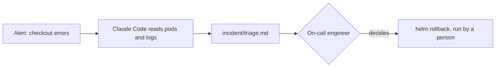

# Triage the live incident

## The problem

At 2am the checkout page fails. The on-call engineer is tired, and prod is on fire. An agent with write access
can make it worse in one command. The 2012 Knight Capital outage lost 440 million dollars in under an hour from
an unchecked deploy ([SEC order](https://www.sec.gov/litigation/admin/2013/34-70694.pdf)).

So Claude Code gets eyes and no hands. It reads pods and logs and writes a short note. A person decides on the
rollback.

For example, `kubectl get pods` shows `CrashLoopBackOff`, and Claude Code writes down why.



## Your challenge

Start Claude Code in the root folder of this course repo, and give it this job:

```text
In parts/03-give-it-eyes/04-triage-the-live-incident/problem/.claude/settings.json allow only read commands:
kubectl get, describe and logs, and helm history. Deny every command that changes the cluster, including
helm rollback. Then fill incident/triage.md for the seat-api crash loop on prod. Use only read commands with
--context kind-tallowmark-prod, and list them under Evidence. Say the cause is a guess. Under Rollback, write the
command but name a person to run it. Add a Watch it section with a /loop line that only reads, and say when to stop. Show me your plan first.
```

Read the plan. Is any write command in the allow list? Does the note name a person?

The prompts that solve this step are in `../solution/prompts.md`. Read them after you try.

## Done when

- The settings deny every command that changes the cluster, and allow none.
- The note has the four sections: What I saw, Evidence, Likely cause, Rollback.
- Evidence holds at least two read commands that name the prod context.
- The rollback names a person and is not run by Claude Code.
- Watch it holds a read-only `/loop` with an interval, and says when to stop.

```bash
bun run verify triage-the-live-incident
```

Expect: `Done. All 8 rules pass.`

## If you get stuck

| What you see | What to ask Claude Code |
|---|---|
| `FAIL the settings deny every write command` | "Add deny rules for apply, delete, rollout, scale, patch, edit, exec, helm rollback and helm upgrade." |
| `FAIL Evidence holds at least two read commands` | "Run the reads and paste each command under Evidence." |
| `FAIL the rollback names a person` | "Say that the on-call engineer runs the rollback, not you." |

## Words you will use

- **Triage**: a fast look to find what is wrong and what to do first.
- **Read-only**: it can look and cannot change anything.
- **Rollback**: go back to the last release that worked.
