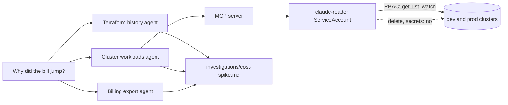

# Give it eyes, not hands

This part moves the **Transformation**: Claude Code reads prod for you, and it cannot change it.

## The problem

Reading is where an agent saves the most time. Ramp connected Claude Code to Datadog and Sentry through MCP. They
say this "could reduce initial incident triage time by up to 80%" ([Ramp](https://claude.com/customers/ramp), a
vendor case study).

But read-only has to be a permission, not a setting. For example, the README of the Kubernetes MCP server says
"`read_only` and `denied_resources` are best-effort guardrails". It says Kubernetes RBAC on its identity "is the
access control to rely on" ([kubernetes-mcp-server](https://github.com/containers/kubernetes-mcp-server)).

Tallowmark's cloud bill jumped. Datadog found that 83 percent of container costs come from idle resources
([State of Cloud Costs](https://www.datadoghq.com/state-of-cloud-costs/)). Something here is idle and growing.

You write no code in this part either. You ask Claude Code to look, and you check what it found.

## What you build

| Step | Minutes | What Claude Code makes for you | The check reads |
|---|---|---|---|
| `connect-the-cluster-read-only` | 25 | A reader ServiceAccount, its ClusterRole and `.mcp.json` | What the reader identity may do on both clusters, and which kubeconfig `.mcp.json` names |
| `quiet-the-noisy-alert` | 20 | A fixed `alerts/seat.rules.yml` and its unit test | The rule run against `alerts/series.yml`: no firing on the three short spikes, firing on the sustained one |
| `split-the-cost-hunt` | 30 | Three subagents in `.claude/agents/` and `investigations/cost-spike.md` | The agents' tools, the report's `root_causes` against the planted pair, and the command log for any write |

## Walkthrough

TODO(part session): the commands for each step, each with an Expect: line.
