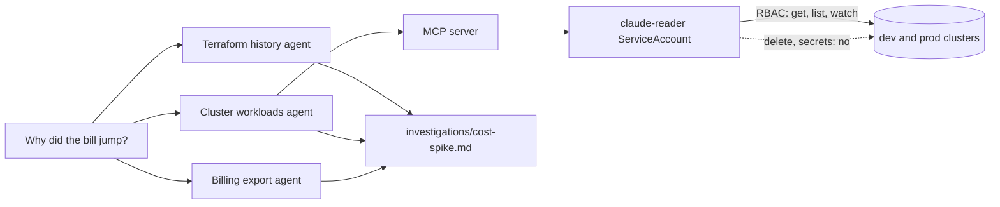

# Give it eyes, not hands

This part moves the **Transformation**: Claude Code reads prod for you, and it cannot change it.

## The problem

Reading is where an agent saves the most time. Ramp connected Claude Code to Datadog and Sentry through MCP. They
say this "could reduce initial incident triage time by up to 80%" ([Ramp](https://claude.com/customers/ramp), a
vendor case study).

But read-only has to be a permission, not a setting. For example, the README of the Kubernetes MCP server says
"`read_only` and `denied_resources` are best-effort guardrails". It says Kubernetes RBAC on its identity "is the
access control to rely on" ([kubernetes-mcp-server](https://github.com/containers/kubernetes-mcp-server)).

Tallowmark's cloud bill jumped. Datadog found that 83 percent of container costs come from idle resources
([State of Cloud Costs](https://www.datadoghq.com/state-of-cloud-costs/)). Something here is idle and growing.

You write no code in this part either. You ask Claude Code to look, and you check what it found.



## What you build

| Step | Minutes | What Claude Code makes for you | The check reads |
|---|---|---|---|
| `connect-the-cluster-read-only` | 25 | A reader ServiceAccount and ClusterRole, its kubeconfig, `.mcp.json` and deny rules | What the reader identity may do on both clusters, which kubeconfig the MCP server uses, and which MCP tools are denied |
| `quiet-the-noisy-alert` | 20 | A fixed `alerts/seat.rules.yml` and its unit test | The rule run against `alerts/series.yml`: no firing on the three short spikes, firing on the sustained one |
| `split-the-cost-hunt` | 30 | Three subagents in `.claude/agents/` and `investigations/cost-spike.md` | The agents' tools, the report's `root_causes` against the planted pair, its sections, and the command log for any write |
| `triage-the-live-incident` | 25 | Read-only settings and `incident/triage.md`, with a rollback a person runs | The deny rules, the evidence commands, the named person and the read-only `/loop` |

## Walkthrough

Each step starts from the last step's sample answer, so you can start any step fresh. Seed the world first, if
you have not yet:

```bash
bun run world
```

Expect: `World: Tallowmark Tickets, repo at world/live/tallowmark-infra`

In the first step, Claude Code writes the reader identity. Ask the practice `kubectl auth can-i` what that
identity may do on the sample answer:

```bash
bun checks/helpers/03-give-it-eyes/rbac.ts parts/03-give-it-eyes/01-connect-the-cluster-read-only/solution get pods
bun checks/helpers/03-give-it-eyes/rbac.ts parts/03-give-it-eyes/01-connect-the-cluster-read-only/solution delete pods
bun checks/helpers/03-give-it-eyes/rbac.ts parts/03-give-it-eyes/01-connect-the-cluster-read-only/solution list secrets
```

Expect: `yes`, then `no`, then `no`.

In the second step, play the recorded latency through the alert rule. On the starter, every window pages:

```bash
bun checks/helpers/03-give-it-eyes/alerts.ts parts/03-give-it-eyes/02-quiet-the-noisy-alert/problem
```

Expect: four lines, each ending in `FIRES`.

To check your work, ask Claude Code. For example, for the step you just finished:

```text
Check my work for this step. Run its check and tell me what it printed. Do not change anything to make it pass.
```

You can also run the checks yourself:

In the third step, a session started inside the step folder loads the three subagents. Its prompts are in the
step README. Check each step when Claude Code is done. Each prints PASS or FAIL lines, and a Try next line under
every FAIL:

```bash
bun run verify connect-the-cluster-read-only
bun run verify quiet-the-noisy-alert
bun run verify split-the-cost-hunt
bun run verify triage-the-live-incident
```

Expect: `Done. All 9 rules pass.`, then 7 and 7 rules, once each step is solved.

Check the whole part in one go:

```bash
bun run verify part give-it-eyes
```

Expect: `Part give-it-eyes is done: 3/3 steps pass.`

## Assignment

**The problem.** The cloud bill jumped in billing period 41. Find out why, without giving Claude Code write access
to anything.

**What you hand in.** A branch or pull request on your fork with these files in the three step folders:

- `k8s/claude-reader.yaml`, `kubeconfig/claude-reader.yaml`, `mcp/kubernetes.toml` and `.mcp.json`.
- The three subagents in `.claude/agents/`.
- `investigations/cost-spike.md`.

**How it is graded.** Each line is yes or no, and a script answers it.

| Question | Check |
|---|---|
| Does `kubectl auth can-i` say no to delete pods and to list secrets, and yes to get pods? | `bun run verify connect-the-cluster-read-only` |
| Does the MCP server use the reader kubeconfig, with its write tools denied? | the same check |
| Do the three subagents have no Edit or Write tool? | `bun run verify split-the-cost-hunt` |
| Do the report's `root_causes` match the two planted causes, and nothing else? | the same check |
| Did nothing but a person change the world? | the same check, on the command log |

**Extension.** Fix the noisy `SeatApiSlow` alert with a promtool unit test that fires only on the sustained
slowdown: `bun run verify quiet-the-noisy-alert`.

## Finished

You now have Claude Code with eyes on both clusters and on the bill. It reads as `claude-reader`, and the cluster
itself refuses its writes. It found two causes of the cost spike and wrote a fix plan for a person to apply.

For example, ask it "why does seat-api restart on prod?" It can list pods and read logs. It cannot delete a pod
to "fix" it.

The next part, `run-it-without-you`, takes you out of the loop. Claude Code reviews Terraform plans in CI with no
write keys, and the guardrails become a kit another team can install.
