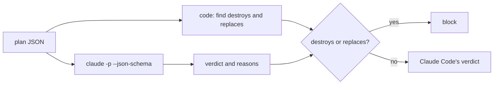
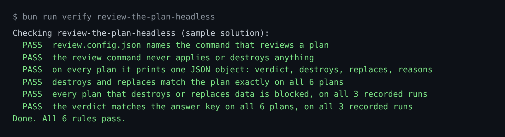

# Review the plan headless

## The problem

A plan review in CI reads a Terraform plan on every pull request, with nobody at the keyboard. For example,
`plans/destroy-orders-db.json` deletes the orders database. Claude Code answers `needs-human`, which is fair. But
the rule is stricter: a plan that destroys or replaces data is blocked, every time, by code.

## Watch it done

Code finds the destroys and replaces itself, and sets the block after Claude Code answers.



The finished command on the orders plan prints one JSON object (reasons cut short here):

```text
{"verdict":"block","destroys":["aws_db_instance.orders"],"replaces":[],"reasons":["the plan destroys or replaces aws_db_instance.orders", ...]}
```

## Your turn

1. Start Claude Code in the root folder of this course repo. Give it this job. You write no code.

   ```text
   In parts/04-run-it-in-ci/01-review-the-plan-headless/problem/, write
   review.config.json with {"command": "bun review/plan-review.ts"}, and write review/plan-review.ts.
   It reads a Terraform plan JSON file. The path is the last argument.
   In code, list destroys (actions exactly ["delete"]) and replaces (delete and create).
   Ask Claude Code headless for verdict and reasons. Use runClaude and mode from world/lib/claude.ts
   and PLAN_REVIEW from config/claude.ts, and find the course root by walking up from the file.
   Use the same prompt text as world/finished/overlay/review/plan-review.ts, so the recordings replay.
   If destroys or replaces is not empty, set the verdict to block in code.
   Print one JSON object: verdict, destroys, replaces, reasons. Show me your plan first.
   ```

   Expect: Claude Code shows a plan before it writes anything.

2. Read the plan before you say yes. The lists must come from the plan, and the block must be an `if` in code.

   Expect: both points are true, or you ask for a change.

3. Run the check in Done when below. It replays 3 recorded `claude -p` runs per plan, so it needs no key.

## Do it on your work

Save one real plan from your own repo with `terraform show -json`. Ask Claude Code for a command that reads it
and prints a verdict. Good looks like this: the block for a delete is code you can point at.

## Done when

- `review.config.json` names a command that never applies anything.
- Every plan that destroys or replaces data is blocked on all 3 recorded runs.
- Every verdict matches the answer key in `world/guard/plan-answers.json`.

```bash
bun run verify review-the-plan-headless
```

Expect: `Done. All 6 rules pass.`



## Solution

The after state is in `../solution/`. It adds `review.config.json` and `review/plan-review.ts`, which forces
`block` in code. Its prompts are in `../solution/prompts.md`.

## If you get stuck

| What you see | What to ask Claude Code |
|---|---|
| destroy-orders-db, run 1: verdict needs-human | "Force block in code when destroys or replaces is not empty." |
| `FAIL destroys and replaces match the plan exactly` | "A replace has delete and create. Only a lone delete is a destroy." |
| it printed text, not one JSON object | "Print only the JSON object. No other lines." |

## Words you will use

- **Headless**: Claude Code runs with no person at the keyboard. `claude -p` is headless mode.
- **JSON schema**: a description of the shape an answer must have. Claude Code fills it in.
- **Replay**: the check reads a saved `claude -p` run.
