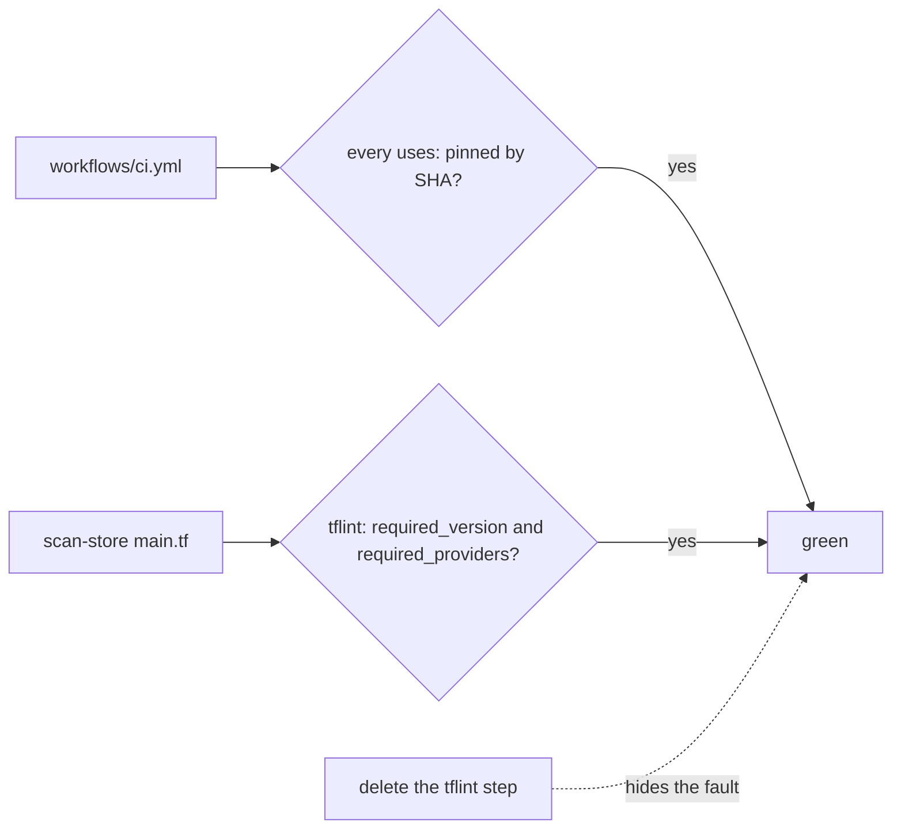
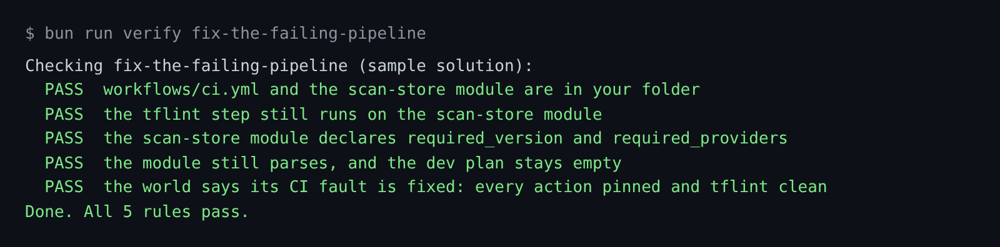

# Fix the failing pipeline

## The problem

Tallowmark's own CI is red. For example, two faults: the actions are not pinned by SHA (one uses `setup-tflint@main`), and
`tflint` fails because the scan-store module does not say which Terraform it needs. Deleting the lint step turns
it green and hides the fault.

## Watch it done

The world's status shows the CI fault, and the fix clears it.



```text
OPEN   Failing CI pipeline: 3 action(s) not pinned to a commit SHA; tflint: scan-store module has no required_providers
```

## Your turn

1. Start Claude Code in the root folder of this course repo. Give it this job. You write no code.

   ```text
   CI fails for parts/04-run-it-in-ci/03-fix-the-failing-pipeline/problem/workflows/ci.yml.
   Read it, the module terraform/modules/scan-store/main.tf next to it, and
   world/seed/tallowmark-infra/.tflint.hcl. Tell me why it fails before you change anything.
   Then fix the cause: pin every action to a full commit SHA, looked up with git ls-remote --tags,
   with the tag in a comment. Give the module a terraform block with required_version and
   required_providers, the same as terraform/envs/dev. Keep the tflint step. Add no resources.
   Show me your plan first.
   ```

   Expect: Claude Code names both causes before it changes anything.

2. Read the plan. It must keep the `tflint` step and add no resource. The lifecycle rule is a different fault,
   for Give it eyes, not hands.

   Expect: the plan only pins actions and adds a terraform block.

3. Run the check in Done when below.

## Do it on your work

Find a red or flaky pipeline of your own. Ask Claude Code to explain why it fails before it changes anything.
Good looks like this: the cause is fixed, the check stays in the pipeline, and nothing new is added.

## Done when

- The `tflint` step still runs on the scan-store module.
- The module declares `required_version` and `required_providers`.
- The module still parses and the dev plan stays empty.
- The world says its CI fault is fixed.

```bash
bun run verify fix-the-failing-pipeline
```

Expect: `Done. All 5 rules pass.`



## Solution

The after state is in `../solution/`. It pins the actions in `workflows/ci.yml` and adds a terraform block to
`terraform/modules/scan-store/main.tf`. The prompts that solve this step are in `../solution/prompts.md`. Read
them after you try.

## If you get stuck

| What you see | What to ask Claude Code |
|---|---|
| `FAIL the tflint step still runs` | "Put the tflint step back and fix the module instead." |
| `... action(s) not pinned to a commit SHA` | "Pin each uses: to the 40 character SHA, not a tag." |
| `FAIL ... the dev plan stays empty` | "Remove the resource you added. This fix only adds a terraform block." |

## Words you will use

- **tflint**: a linter for Terraform. It reads the code and reports mistakes before a plan.
- **Pin**: point at one exact version that cannot change, here a commit SHA.
- **Terraform block**: the `terraform { }` block that says which Terraform and providers the code needs.

## Go further

- Also pin `plan-review.yml` in the same folder.
