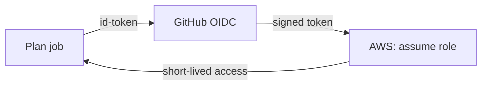

# Use OIDC, not a stored token

## The problem

For example, the plan workflow stores an AWS key as a GitHub secret. It lives until someone rotates it, and a bad package or
an injected prompt can read it. Most teams still keep such keys: 58 percent in the
[State of DevSecOps](https://www.datadoghq.com/state-of-devsecops-2025/) report.

## Watch it done

With OIDC, short for OpenID Connect, the job asks AWS for a token that lasts a short time. Nothing is stored,
so a stolen token is dead by lunch.



Before, the job holds these lines:

```text
AWS_ACCESS_KEY_ID: ${{ secrets.AWS_ACCESS_KEY_ID }}
AWS_SECRET_ACCESS_KEY: ${{ secrets.AWS_SECRET_ACCESS_KEY }}
```

After, they are gone, and the job assumes a role instead.

## Your turn

1. Start Claude Code in the root folder of this course repo. Give it this job.

   ```text
   In parts/04-run-it-in-ci/04-use-oidc-not-a-stored-token/problem/workflows/plan.yml remove the AWS key
   secrets. Give the job permissions contents read and id-token write. Add the aws-actions/configure-aws-credentials
   step with role-to-assume arn:aws:iam::123456789012:role/tallowmark-plan-readonly and region eu-west-1. Pin every
   uses: by a full commit SHA. The job only plans and never applies. Show me the diff first.
   ```

   Expect: Claude Code shows a diff before it writes.

2. Read the diff. Is any secret left? Does the job apply anything?

   Expect: no `secrets.AWS` line is left and nothing applies.

3. Run the check in Done when below.

## Do it on your work

Search your own workflows for stored cloud keys: `grep -rn "secrets.AWS" .github/workflows`. Ask Claude Code to
swap each one for a role the job assumes. Good looks like this: no key is named, and the role can only do what
the job needs.

## Done when

- The job asks for `id-token: write` and `contents: read`, and nothing wider.
- It assumes a role. No AWS key or secret is named anywhere.
- Every `uses:` is pinned by a 40 character SHA.
- The job plans and never applies.

```bash
bun run verify use-oidc-not-a-stored-token
```

Expect: `Done. All 5 rules pass.`

## Solution

The after state is in `../solution/`. Its `workflows/plan.yml` drops the key secrets and adds the role step. The
prompts that solve this step are in `../solution/prompts.md`. Read them after you try.

## If you get stuck

| What you see | What to ask Claude Code |
|---|---|
| `FAIL no AWS key or secret is named` | "Remove every secrets.AWS line, including the env block." |
| `FAIL every uses: is pinned` | "Pin each uses: by a full 40 character commit SHA." |

## Words you will use

- **OIDC**: a way for a job to prove who it is and get a short-lived token.
- **Role**: a set of AWS rights that a job may borrow for a short time.

## Go further

- Limit the role so only your main branch may assume it.
