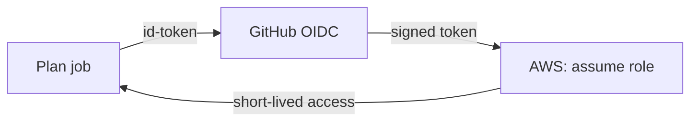

# Use OIDC, not a stored token

## The problem

The workflow stores an AWS key as a GitHub secret. A key like that lives until someone rotates it. If a bad
package or an injected prompt reads it, the thief owns it. With OIDC, short for OpenID Connect, the job asks
AWS for a token that lasts a short time, and nothing is stored. Most teams still keep long-lived keys: 58 percent
in the [State of DevSecOps](https://www.datadoghq.com/state-of-devsecops-2025/) report.

For example, the role lasts one hour, and a stolen token is dead by lunch.



## Your challenge

Start Claude Code in the root folder of this course repo, and give it this job:

```text
In parts/04-run-it-in-ci/04-use-oidc-not-a-stored-token/problem/workflows/plan.yml remove the AWS key
secrets. Give the job permissions contents read and id-token write. Add the aws-actions/configure-aws-credentials
step with role-to-assume arn:aws:iam::123456789012:role/tallowmark-plan-readonly and region eu-west-1. Pin every
uses: by a full commit SHA. The job only plans and never applies. Show me the diff first.
```

Read the diff. Is any secret left? Does the job apply anything?

The prompts that solve this step are in `../solution/prompts.md`. Read them after you try.

## Done when

- The job asks for `id-token: write` and `contents: read`, and nothing wider.
- It assumes a role. No AWS key or secret is named anywhere.
- Every `uses:` is pinned by a 40 character SHA.
- The job plans and never applies.

```bash
bun run verify use-oidc-not-a-stored-token
```

Expect: `Done. All 5 rules pass.`

## If you get stuck

| What you see | What to ask Claude Code |
|---|---|
| `FAIL no AWS key or secret is named` | "Remove every secrets.AWS line, including the env block." |
| `FAIL every uses: is pinned` | "Pin each uses: by a full 40 character commit SHA." |

## Words you will use

- **OIDC**: a way for a job to prove who it is and get a short-lived token.
- **Role**: a set of AWS rights that a job may borrow for a short time.
