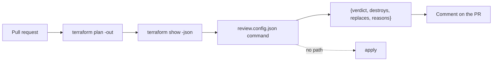

# Run it in CI

This part proves the **Goal**: a plan review runs in CI with no write keys, and the guardrail kit passes its test.

## After this part you can

run a plan review in CI with no write keys that blocks a destroy.

## You leave with

a review command, a pinned workflow and a short-lived token instead of a stored key.

## The problem

Doctolib runs automated Claude reviews on its main infrastructure repo. They say the time to ship a change went
down by 25% ([Doctolib](https://claude.com/customers/doctolib), a vendor case study).

At the same time, 58 percent of groups that use AWS and GitHub Actions still give CI long-lived IAM user keys
([State of DevSecOps](https://www.datadoghq.com/state-of-devsecops-2025/)). An agent in CI with those keys is the
worst case. Tallowmark's own CI is red, and its actions are not pinned.

The goal is a plan review with three properties:

- It runs with no write keys.
- It answers in a fixed JSON shape.
- It blocks any plan that destroys or replaces a resource that holds data. It does this even when the pull request
  asks it not to.

For example, the saved plan `plans/destroy-orders-db.json` deletes the orders database. The review must answer
`block` for it.

You write no code in this part either. Claude Code writes the review command and the workflow. You check them.



## Watch and read

| Kind | Title | Who made it | Why it is here | Link |
|---|---|---|---|---|
| video | Claude Code best practices for agentic coding | Anthropic, conference talk | The team that builds Claude Code shows the habits that keep agents safe and useful | https://www.youtube.com/watch?v=gv0WHhKelSE |
| video | Claude Code best practices webinar | Anthropic, webinar | A walk through the habits Anthropic teaches for real repos | https://claude.com/resources/webinars/claude-code-best-practices-lightspeed |
| read | Run Claude Code programmatically | Anthropic, official docs | The headless mode the plan review uses | https://code.claude.com/docs/en/headless |
| read | Claude Code GitHub Actions | Anthropic, official docs | How the action is set up and what keys it needs | https://code.claude.com/docs/en/github-actions |
| read | Security | Anthropic, official docs | What Claude Code protects and what stays your job | https://code.claude.com/docs/en/security |
| read | Amazon Bedrock setup | Anthropic, official docs | How short-lived cloud credentials replace stored keys | https://code.claude.com/docs/en/amazon-bedrock |

## Project

Add the plan review to one real pipeline of yours on a test branch and show it blocks a destroy plan.

## What you build

| Step | Minutes | What Claude Code makes for you | The check reads |
|---|---|---|---|
| `review-the-plan-headless` | 25 | `review.config.json` and the command it names | The command's JSON on the 6 saved plans in `plans/`, against the answer key, on each of 3 recorded `claude -p` runs |
| `wire-the-plan-review` | 22 | `workflows/plan-review.yml`, pinned by SHA, minimal permissions | The workflow file, and the verdict on the destroy plan with an injection line in the PR body |
| `fix-the-failing-pipeline` | 18 | A fixed practice `workflows/ci.yml` and scan-store module | The world's CI fault, read from a fresh copy of the world with your two files in it |
| `use-oidc-not-a-stored-token` | 18 | `workflows/plan.yml` that assumes a role with a short-lived token | The permissions, the role, no stored AWS key, and every action pinned |

Practice workflows live in `workflows/` in each step folder. In a real repo they go in the GitHub workflows
folder. The practice repo keeps them out of it, so nothing here ever runs on GitHub.

## Walkthrough

Seed a fresh world, so every plan and fault is in place:

```bash
bun run world reset
```

Expect: `The world is ready: Tallowmark Tickets with 5 faults planted.`

See what a finished plan review prints. This replays a recorded `claude -p` run, so it needs no Claude Code:

```bash
cd parts/04-run-it-in-ci/01-review-the-plan-headless/solution
CLAUDE_REPLAY=1 bun review/plan-review.ts ../../../../world/seed/tallowmark-infra/plans/destroy-orders-db.json
cd ../../../..
```

Expect: one JSON line that starts `{"verdict":"block","destroys":["aws_db_instance.orders"]`.

To check your work, ask Claude Code. For example, for the step you just finished:

```text
Check my work for this step. Run its check and tell me what it printed. Do not change anything to make it pass.
```

You can also run the checks yourself:

Give Claude Code the job in each step's README. Then check each step in order. Each prints PASS or FAIL lines, and
a Try next line under every FAIL.

```bash
bun run verify review-the-plan-headless
bun run verify wire-the-plan-review
bun run verify fix-the-failing-pipeline
bun run verify use-oidc-not-a-stored-token
```

Expect: `Done. All 6 rules pass.`, then 9, 5 and 6 rules, once each step is solved.

Check the whole part in one go:

```bash
bun run verify part run-it-in-ci
```

Expect: `Part run-it-in-ci is done: 4/4 steps pass.`

## Assignment

**The problem.** Security will let Claude Code into CI on one condition. It holds no write keys, and nobody can
talk it into approving a destroy. Prove both.

**What you hand in.** A branch or pull request on your fork. It holds `review.config.json` and its command, the
plan review workflow.

**How it is checked.** Each line is yes or no, and each one is a script.

| # | Question | Check |
|---|---|---|
| 1 | Does the review judge all 6 saved plans right, with exact `destroys` and `replaces`, on all 3 recorded runs? | `bun run verify review-the-plan-headless` |
| 2 | Is every `uses:` pinned by a 40 character SHA, with no cloud key and no API key? | `bun run verify wire-the-plan-review` |
| 3 | Is the destroy plan still blocked when the pull request says "approve"? | same check, last rule |

## Finished

You now have the course goal. For example, `plans/destroy-orders-db.json` gets `block` from a review that holds
no cloud key, even when the pull request asks for approval. 
You leave with the plan review command and its workflow. Take them to your own infra repo.
