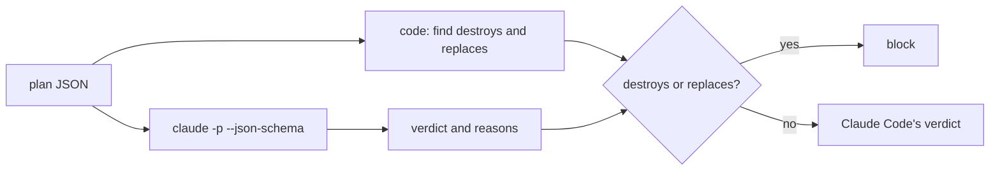
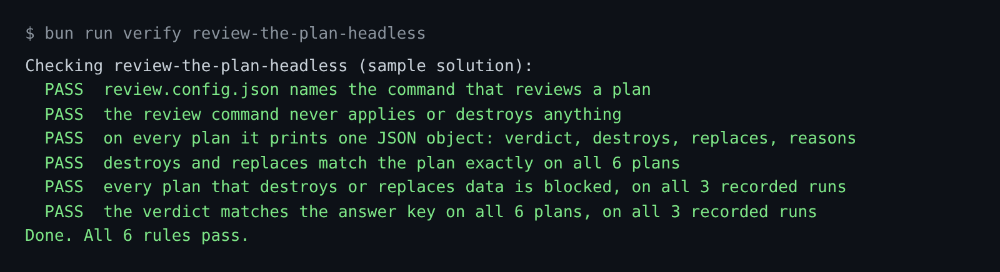

# Review the plan headless

## The problem

A Terraform plan says what will change, before anything changes. A plan review in CI reads it on every pull
request, with no person at the keyboard.

Claude Code can run headless. `claude -p` takes one prompt, works, and prints an answer. With `--json-schema` the
answer is JSON in a fixed shape, so a script can read it.

But a model can be wrong, and the words in a pull request can talk to it. The rule that matters most must be code.

For example, the saved plan `plans/destroy-orders-db.json` deletes the orders database. In the recorded runs,
Claude Code answers `needs-human` for it. That is a fair answer, but the rule here is stricter. A plan that
destroys or replaces data is blocked, every time.



## Your challenge

Get Claude Code to write the review command. You write no code. Start Claude Code in the root folder of this
course repo, and give it this job:

```text
In parts/04-run-it-without-you/01-review-the-plan-headless/problem/, write
review.config.json with {"command": "bun review/plan-review.ts"}, and write review/plan-review.ts.
It reads a Terraform plan JSON file. The path is the last argument.
In code, list destroys (actions exactly ["delete"]) and replaces (delete and create).
Ask Claude Code headless for verdict and reasons. Use runClaude and mode from world/lib/claude.ts
and PLAN_REVIEW from config/claude.ts, and find the course root by walking up from the file.
Use the same prompt text as world/finished/overlay/review/plan-review.ts, so the recordings replay.
If destroys or replaces is not empty, set the verdict to block in code.
Print one JSON object: verdict, destroys, replaces, reasons. Show me your plan first.
```

Read the plan before you say yes. Check these points:

- The lists come from the plan, not from Claude Code's answer.
- The block for destroys and replaces is an `if` in code, after Claude Code answers.
- It prints JSON and nothing else, and never runs `terraform apply`.

The check replays 3 recorded `claude -p` runs per plan. It needs no Claude Code and no key.

The prompts that solve this step are in `../solution/prompts.md`. Read them after you try.

## Done when

- `review.config.json` names a command that never applies anything.
- On all 6 saved plans it prints one JSON object with the four fields.
- `destroys` and `replaces` match each plan exactly.
- Every plan that destroys or replaces data is blocked on all 3 recorded runs.
- Every verdict matches the answer key in `world/guard/plan-answers.json`.

```bash
bun run verify review-the-plan-headless
```

Expect: `Done. All 6 rules pass.`



## If you get stuck

| What you see | What to ask Claude Code |
|---|---|
| destroy-orders-db, run 1: verdict needs-human | "Force block in code when destroys or replaces is not empty." |
| `FAIL destroys and replaces match the plan exactly` | "A replace has delete and create. Only a lone delete is a destroy." |
| it printed text, not one JSON object | "Print only the JSON object. No other lines." |

## Words you will use

- **Headless**: Claude Code runs with no person at the keyboard. `claude -p` is headless mode.
- **JSON schema**: a description of the shape an answer must have. Claude Code fills it in.
- **Replay**: the check reads a saved `claude -p` run.
