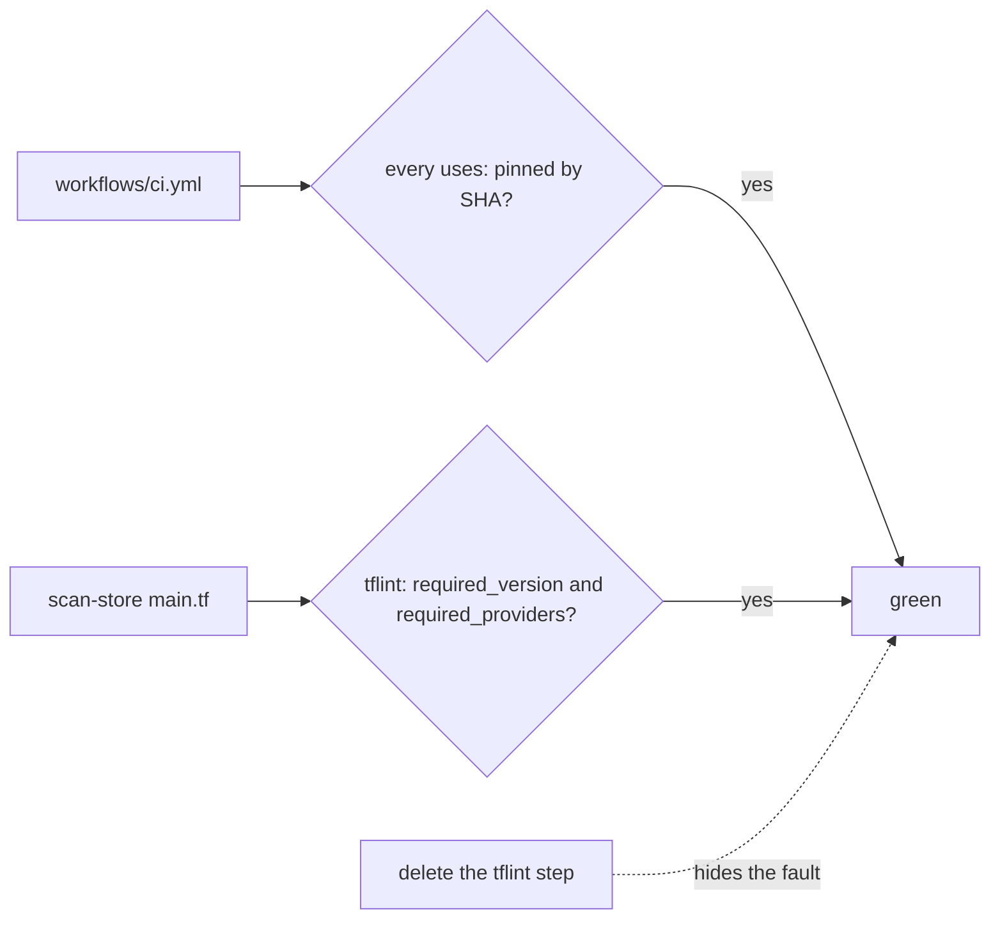
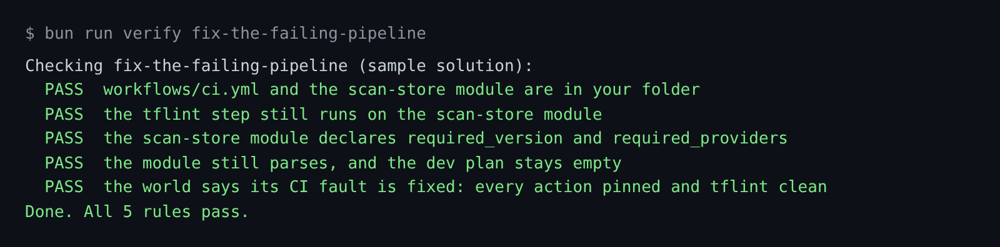

# Fix the failing pipeline

## The problem

Tallowmark's own CI is red, and nobody has fixed it. A red pipeline that stays red teaches people to merge
anyway.

It has two faults. The workflow uses actions by tag, and one by branch (`setup-tflint@main`), so anyone who can
move that tag or branch can run code in the job. And `tflint` fails on the scan-store module, because the module
does not say which Terraform and which provider it needs.

The quick fix is to delete the lint step. That makes the pipeline green and hides the fault.

For example, the world's status shows the CI fault like this:

```text
OPEN   Failing CI pipeline: 3 action(s) not pinned to a commit SHA; tflint: scan-store module has no required_providers
```



## Your challenge

Get Claude Code to find out why CI fails, then fix the cause. You write no code. In a real repo `ci.yml` lives in
the GitHub workflows folder. The practice repo keeps it in `workflows/`.

Start Claude Code in the root folder of this course repo, and give it this job:

```text
CI fails for parts/04-run-it-without-you/03-fix-the-failing-pipeline/problem/workflows/ci.yml.
Read it, the module terraform/modules/scan-store/main.tf next to it, and
world/seed/tallowmark-infra/.tflint.hcl. Tell me why it fails before you change anything.
Then fix the cause: pin every action to a full commit SHA, looked up with git ls-remote --tags,
with the tag in a comment. Give the module a terraform block with required_version and
required_providers, the same as terraform/envs/dev. Keep the tflint step. Add no resources.
Show me your plan first.
```

Read the plan before you say yes. Check these points:

- It names both causes: unpinned actions and the missing terraform block.
- It keeps the `tflint` step.
- It adds no resource. The lifecycle rule is a different fault, for part three.

The prompts that solve this step are in `../solution/prompts.md`. Read them after you try.

## Done when

- The `tflint` step still runs on the scan-store module.
- The module declares `required_version` and `required_providers`.
- The module still parses and the dev plan stays empty.
- The world says its CI fault is fixed.

```bash
bun run verify fix-the-failing-pipeline
```

Expect: `Done. All 5 rules pass.`



## If you get stuck

| What you see | What to ask Claude Code |
|---|---|
| `FAIL the tflint step still runs` | "Put the tflint step back and fix the module instead." |
| `... action(s) not pinned to a commit SHA` | "Pin each uses: to the 40 character SHA, not a tag like v7.0.1." |
| `FAIL ... the dev plan stays empty` | "Remove the resource you added. This fix only adds a terraform block." |

## Words you will use

- **tflint**: a linter for Terraform. It reads the code and reports mistakes before a plan.
- **Pin**: point at one exact version that cannot change, here a commit SHA.
- **Terraform block**: the `terraform { }` block that says which Terraform and providers the code needs.
