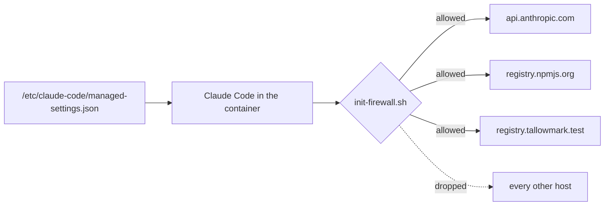
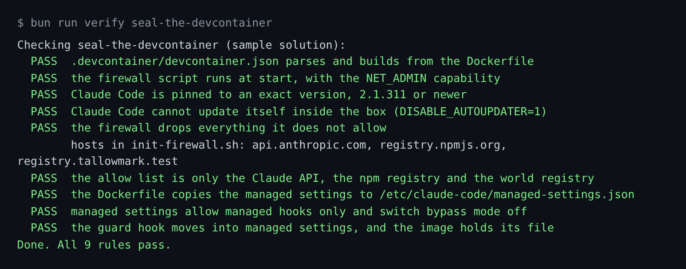

# Seal the devcontainer

## The problem

Claude Code runs commands on your laptop, with your keys nearby. A package it installs can run code too.

Once, 19 bad versions of `nx` packages ran a script when they were installed. The script searched the
disk for credentials and posted them to a public repo. It even carried a prompt that started "You are a
file-search agent" ([Nx advisory GHSA-cxm3-wv7p-598c](https://github.com/nrwl/nx/security/advisories/GHSA-cxm3-wv7p-598c)).

A dev container is a box for the work. Inside it, a firewall decides which hosts the box can reach. Managed
settings decide what Claude Code may do, and nothing in the repo can change them.

For example, inside a sealed box `curl https://example.com` gets no answer. Claude Code can still reach
`api.anthropic.com`, and `npm install` can still reach `registry.npmjs.org`.



## Your challenge

Get Claude Code to write the container. You write no code. Start Claude Code in the root folder of this course
repo, and give it this job:

```text
Read https://code.claude.com/docs/en/devcontainer and the managed settings page in the same docs.
In parts/04-run-it-without-you/04-seal-the-devcontainer/problem/.devcontainer/, write
devcontainer.json, a Dockerfile, init-firewall.sh and managed-settings.json.
The Dockerfile installs @anthropic-ai/claude-code at the exact version that claude --version prints, sets DISABLE_AUTOUPDATER=1,
and copies managed-settings.json to /etc/claude-code/managed-settings.json.
The firewall drops everything except api.anthropic.com, registry.npmjs.org and registry.tallowmark.test.
It runs at start, with --cap-add=NET_ADMIN. Managed settings set allowManagedHooksOnly to true and
disableBypassPermissionsMode to disable. Then the repo's hook stops running, so copy
.claude/hooks/guard-infra.ts into /etc/claude-code/hooks/ and wire it in the managed settings.
Show me your plan first.
```

Read the plan before you say yes. Count the hosts in the firewall. There must be three.

The check reads the files. It builds no image. To try the box for real, open the folder in VS Code and choose
"Reopen in Container".

The prompts that solve this step are in `../solution/prompts.md`. Read them after you try.

## Done when

- `devcontainer.json` builds from the Dockerfile and runs the firewall at start, with `NET_ADMIN`.
- Claude Code is pinned to an exact version and cannot update itself.
- The firewall drops by default and allows only the three hosts.
- Managed settings are copied to `/etc/claude-code/managed-settings.json`, allow managed hooks only, switch bypass
  mode off, and carry the guard hook.

```bash
bun run verify seal-the-devcontainer
```

Expect: `Done. All 9 rules pass.`



## If you get stuck

| What you see | What to ask Claude Code |
|---|---|
| `hosts in init-firewall.sh: ... github.com ...` | "Remove every host except the three. A blocked install is safer than an open box." |
| `FAIL Claude Code is pinned to an exact version` | "Pin @anthropic-ai/claude-code to the exact version that claude --version prints, not latest." |
| `FAIL the guard hook moves into managed settings` | "allowManagedHooksOnly turns off the repo's hook. Wire the guard in managed settings." |

## Words you will use

- **Dev container**: a container your editor opens your project in, defined by `.devcontainer/devcontainer.json`.
- **Allow list**: the only hosts the firewall lets through. Everything else is dropped.
- **Managed settings**: settings in a system folder. They sit above every other settings file.
