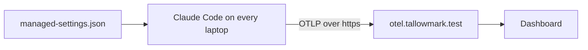

# Export the telemetry

## The problem

The platform team needs to know who runs Claude Code, how often, and what it costs. Asking each developer to set
an env var fails, because people forget. Managed settings sit above every other settings file, so one file turns
telemetry on for everyone. Claude Code sends it as OpenTelemetry, a standard way to send metrics and logs.

For example, the dashboard shows 40 sessions yesterday and what they cost.



## Your challenge

Start Claude Code in the root folder of this course repo, and give it this job:

```text
Read the monitoring page in the Claude Code docs. In
parts/04-run-it-without-you/06-export-the-telemetry/problem/managed/managed-settings.json keep
allowManagedHooksOnly and add an env block. Turn telemetry on. Export metrics and logs with OTLP over grpc to
https://otel.tallowmark.test:4317. Do not log what people type. Put no token in the file. Show me the file first.
```

Read the file. Is the collector on your own host? Could a secret leak from it?

The prompts that solve this step are in `../solution/prompts.md`. Read them after you try.

## Done when

- Telemetry is on, with metrics and logs sent over OTLP.
- The endpoint is an https address that is not on this machine.
- What people type is not exported, and the file holds no token.
- The old managed rule, managed hooks only, is still there.

```bash
bun run verify export-the-telemetry
```

Expect: `Done. All 6 rules pass.`

## If you get stuck

| What you see | What to ask Claude Code |
|---|---|
| `FAIL the endpoint is https and not on this machine` | "Use https://otel.tallowmark.test:4317, not localhost." |
| `FAIL prompts stay out of the export` | "Set OTEL_LOG_USER_PROMPTS to 0, or leave it out." |

## Words you will use

- **OpenTelemetry**: an open standard for sending metrics and logs to a collector.
- **Collector**: a server that receives telemetry and passes it to a dashboard.
