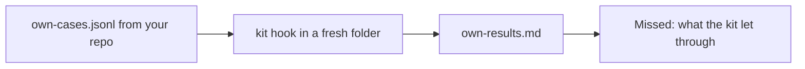

# Run the kit on your repo

## The problem

The kit passed the course's 45 calls. Those calls are Tallowmark's, not yours. A kit that has never seen your
commands proves little. Your own repo has its own dangerous calls, such as a staging apply or a bucket delete,
and its own daily safe ones.

For example, `terraform -chdir=infra/staging apply` is in your scripts, and the course never saw it.



## Your challenge

Start Claude Code in the root folder of this course repo, and give it this job:

```text
Read my repo's scripts and CI files. In parts/04-run-it-without-you/08-run-the-kit-on-your-repo/problem/
own-cases.jsonl write at least five dangerous commands from my repo and three safe ones I run every day, one JSON
line each, with id, expect, tool_name, tool_input and why. Do not reuse a case from world/guard/cases.jsonl.
Run each through kit/hooks/guard-infra.ts as a PreToolUse call. Fill own-results.md with the repo, how many were
blocked and allowed, and every call the kit got wrong under Missed. Show me the list first.
```

Read the list. Would a person on your team run each safe command? Is each dangerous command real?

The prompts that solve this step are in `../solution/prompts.md`. Read them after you try.

## Done when

- `own-cases.jsonl` has at least five calls to block and three to allow.
- At least three commands are new, not from the course cases.
- The kit gets every case right in a fresh folder.
- `own-results.md` names the repo, and its counts match a real run.

```bash
bun run verify run-the-kit-on-your-repo
```

Expect: `Done. All 6 rules pass.`

## If you get stuck

| What you see | What to ask Claude Code |
|---|---|
| `FAIL at least three commands are new` | "Replace the course cases with commands from my scripts and CI files." |
| `FAIL the kit gets every case right` | "Fix the hook for the missed call, then run the cases again." |
| `FAIL the counts match a real run` | "Run the cases again and copy the real counts." |

## Words you will use

- **Case**: one tool call and what the kit should do with it, block or allow.
- **Missed**: a call the kit got wrong.
